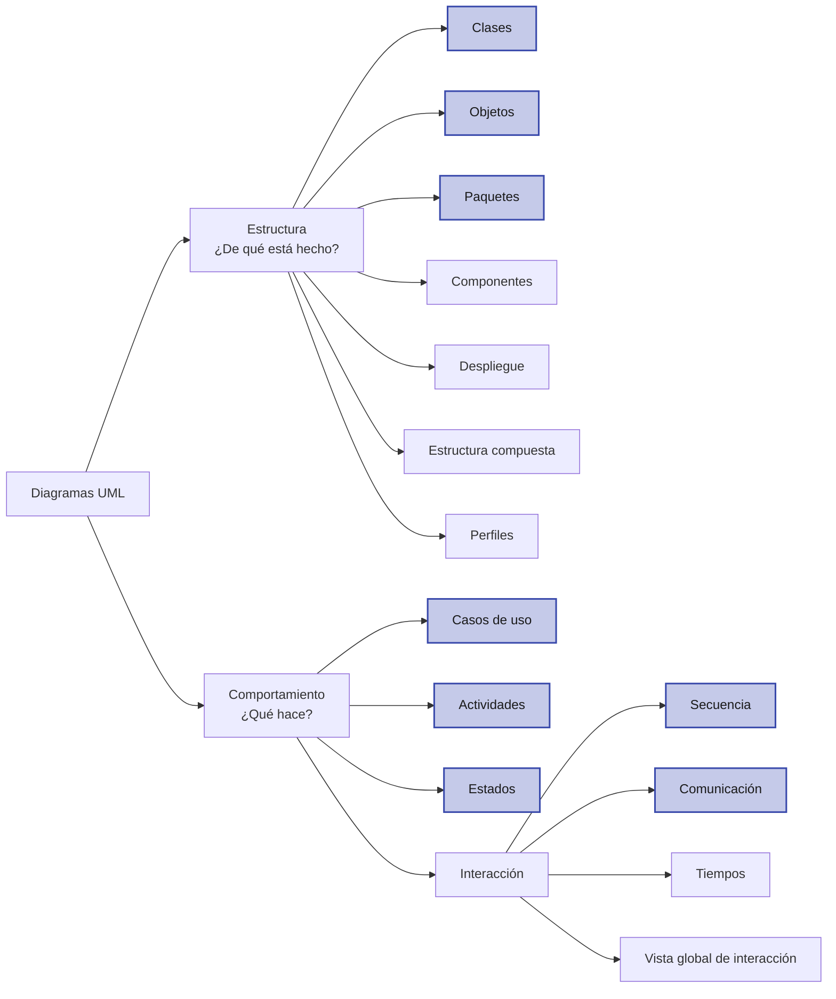
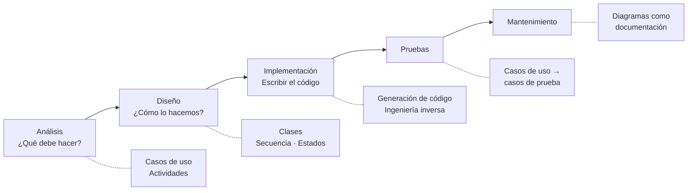

# 1. Introducción a UML

## 1.1. ¿Por qué modelar?

Nadie construye un edificio sin planos. Antes de levantar una pared, arquitectos, ingenieros y constructores se ponen de acuerdo sobre qué se va a construir usando dibujos que todos entienden. En el software ocurre lo mismo: cuando un programa tiene decenas de clases, varias personas trabajando y requisitos que cambian, **escribir código directamente** deja de ser suficiente.

Un **modelo** es una representación simplificada de un sistema que deja fuera los detalles irrelevantes para centrarse en lo que importa en cada momento. Modelar sirve para:

- **Entender** el problema antes de resolverlo.
- **Comunicar** el diseño al resto del equipo (y al cliente) sin leer código.
- **Detectar errores pronto**, cuando corregirlos es barato: es mucho más fácil borrar una caja de un dibujo que reescribir mil líneas de Java.
- **Documentar** el sistema para quien lo mantenga después.

Para que los dibujos signifiquen lo mismo para todos hace falta un lenguaje común. Ese lenguaje es **UML**.

## 1.2. Qué es UML

**UML** (*Unified Modeling Language*, Lenguaje Unificado de Modelado) es un **lenguaje gráfico estándar** para visualizar, especificar, construir y documentar los elementos de un sistema de software orientado a objetos.

### Un poco de historia

A principios de los años 90 existían decenas de métodos y notaciones para modelar sistemas orientados a objetos, y cada equipo dibujaba a su manera. Tres de sus autores más influyentes, Grady Booch, James Rumbaugh e Ivar Jacobson, se unieron en la empresa Rational Software y **unificaron sus notaciones** en una sola. De ahí el nombre. En 1997 el organismo de estandarización **OMG** (*Object Management Group*) adoptó UML como estándar, y desde entonces lo mantiene.

La versión de referencia actual es **UML 2.5.1**, publicada por el OMG, y la familia UML 2 también es una norma internacional (**ISO/IEC 19505**).

### Qué es UML y qué no es

Es habitual confundir UML con otras cosas. Conviene aclararlo desde el principio:

| UML **es**… | UML **no es**… |
|---|---|
| Un **lenguaje** de modelado: define símbolos y reglas para dibujar | Una **metodología**: no dice qué pasos seguir para desarrollar un proyecto |
| Un **estándar** abierto, el mismo para todos los equipos | Una **herramienta** concreta: se puede dibujar con papel, con draw.io o con PlantUML |
| **Independiente** del lenguaje de programación | Un lenguaje de programación: no se ejecuta |
| **Visual**: un diagrama se entiende de un vistazo | Un sustituto del código: describe el sistema, no lo implementa |

## 1.3. Características de UML

- **Estándar y universal.** Un diagrama UML dibujado en Madrid lo entiende un equipo en Tokio.
- **Visual y semiformal.** Combina símbolos precisos con texto en lenguaje natural (nombres, notas).
- **Independiente del lenguaje y de la herramienta.** Un mismo diagrama de clases puede acabar en Java, C#, Python…
- **Orientado a objetos.** Sus conceptos (clase, objeto, herencia, asociación…) son los de la POO que ya conoces.
- **Extensible.** Permite añadir significado propio con **estereotipos** (`<<interface>>`, `<<abstract>>`…) y notas.
- **Con muchos diagramas.** Cada diagrama ofrece una **vista distinta** del mismo sistema; ninguno lo cuenta todo.

## 1.4. Los diagramas UML

UML 2 define **14 tipos de diagrama**, que se agrupan en dos grandes familias según la pregunta que responden:

- **Diagramas de estructura**: ¿*de qué está hecho* el sistema? Muestran los elementos que lo forman y cómo se relacionan, sin hablar del paso del tiempo.
- **Diagramas de comportamiento**: ¿*qué hace* el sistema y cómo evoluciona? Muestran funcionalidades, secuencias de mensajes, procesos y cambios de estado.



En este curso estudiaremos los diagramas resaltados, que son los que se usan a diario en el desarrollo de aplicaciones:

| Diagrama | Familia | Pregunta que responde | Capítulos |
|---|---|---|---|
| **Clases** | Estructura | ¿Qué clases hay, qué datos y operaciones tienen y cómo se relacionan? | 3 a 10 |
| **Objetos** | Estructura | ¿Cómo son los objetos concretos en un instante dado? | 3 y 5 |
| **Paquetes** | Estructura | ¿Cómo se agrupan las clases? | 8 |
| **Casos de uso** | Comportamiento | ¿Qué puede hacer cada usuario con el sistema? | 12 |
| **Secuencia** | Comportamiento (interacción) | ¿Qué mensajes se envían los objetos y en qué orden? | 13 |
| **Colaboración** (comunicación) | Comportamiento (interacción) | ¿Qué objetos colaboran y qué mensajes se envían? | 13 |
| **Actividades** | Comportamiento | ¿Qué pasos sigue un proceso y qué decisiones hay? | 14 |
| **Estados** | Comportamiento | ¿Por qué estados pasa un objeto durante su vida? | 15 |

### Un mismo sistema, tres miradas

Estas son tres vistas de la empresa de alquiler que ya conoces del curso de POO. Fíjate en que **cada diagrama cuenta algo distinto** y que ninguno es «el bueno»:

=== "Estructura: clases"

    ```mermaid
    classDiagram
        class Flota {
            -nombre : String
        }
        class Vehiculo {
            <<abstract>>
            -matricula : String
            +costeAlquiler(dias : int) double*
        }
        class Alquiler {
            -dias : int
            +getTotal() double
        }
        Flota "1" o-- "0..*" Vehiculo : agrupa
        Alquiler "*" --> "1" Vehiculo : de
    ```

=== "Comportamiento: secuencia"

    ```mermaid
    sequenceDiagram
        actor Empleado
        participant Flota
        participant Alquiler
        participant Vehiculo
        Empleado->>Flota: buscarPorMatricula("5671BCD")
        Flota-->>Empleado: vehiculo
        Empleado->>Alquiler: new Alquiler(vehiculo, conductor, 3)
        Empleado->>Alquiler: getTotal()
        Alquiler->>Vehiculo: costeAlquiler(3)
        Vehiculo-->>Alquiler: 120.0
        Alquiler-->>Empleado: 120.0
    ```

=== "Comportamiento: estados"

    ```mermaid
    stateDiagram-v2
        [*] --> Parado
        Parado --> EnMarcha : ponerEnMarcha()
        EnMarcha --> EnMarcha : acelerar() / frenar()
        EnMarcha --> Parado : parar()
    ```

El primero describe **qué piezas** hay; el segundo, **cómo colaboran** al calcular el precio de un alquiler; el tercero, **cómo cambia** un vehículo a lo largo de su vida. Aún no sabes leerlos con detalle, y no hace falta: a lo largo del curso los iremos desgranando.

## 1.5. UML en el desarrollo de software

### Dónde encajan los diagramas en el ciclo de vida

En la UT1 viste las **fases del desarrollo** de software. UML acompaña a todas ellas, y cada fase tiende a usar unos diagramas más que otros:



- **Análisis**: los casos de uso y los diagramas de actividades recogen *qué* necesita el cliente.
- **Diseño**: los diagramas de clases, de secuencia y de estados definen *cómo* se organiza el sistema.
- **Implementación**: el diagrama de clases se traduce a código (**ingeniería directa**), y a veces se hace el camino contrario (**ingeniería inversa**). Lo verás en el capítulo 10.
- **Pruebas**: cada caso de uso es una fuente de casos de prueba.
- **Mantenimiento**: los diagramas permiten entender un sistema ajeno sin leer todo el código.

### UML y las metodologías de desarrollo

UML **no impone** una forma de trabajar, y por eso se usa de formas distintas según la metodología:

- En metodologías **iterativas y orientadas a objetos** como el *Proceso Unificado* (RUP), que nació junto a UML, los modelos se elaboran con detalle en cada iteración.
- En metodologías **ágiles**, se usa «lo justo»: bocetos en una pizarra para discutir una idea, sin pretender documentarlo todo.

Una forma útil de pensarlo, popularizada por Martin Fowler, es que un diagrama puede usarse como:

| Uso | Para qué | Nivel de detalle |
|---|---|---|
| **Boceto** | Pensar y conversar sobre una idea | Bajo: solo lo esencial |
| **Plano** | Describir un diseño completo para que otros lo implementen | Alto |
| **Lenguaje de programación** | Generar el código automáticamente desde el modelo | Muy alto (menos habitual) |

En este curso trabajaremos sobre todo en los dos primeros usos.

## 1.6. Piezas comunes a todos los diagramas

Antes de entrar en cada diagrama, conviene conocer tres elementos que aparecen en todos ellos:

| Elemento | Qué es | Ejemplo |
|---|---|---|
| **Estereotipo** | Etiqueta entre `<<` `>>` (o « ») que añade un significado a un elemento | `<<interface>>`, `<<abstract>>` |
| **Nota** | Comentario libre, unido al elemento al que se refiere con una línea discontinua | «Tarifa: 40 € al día» |
| **Restricción** | Condición entre llaves que debe cumplirse | `{velocidad >= 0}` |

Además, todo diagrama debería tener un **título** y respetar una regla de oro: **cada diagrama responde a una sola pregunta**. Si un dibujo intenta contarlo todo, no se entiende nada.

## Resumen del capítulo

- Un **modelo** simplifica un sistema para entenderlo, comunicarlo y detectar errores pronto.
- **UML** es un lenguaje gráfico estándar (OMG, versión 2.5.1), independiente del lenguaje de programación. No es una metodología ni una herramienta.
- Hay 14 diagramas: de **estructura** (¿de qué está hecho?) y de **comportamiento** (¿qué hace?). Cada uno ofrece una vista distinta.
- UML acompaña a todas las fases del ciclo de vida y se adapta a distintas metodologías, desde la más formal a la más ágil.
- Los **estereotipos**, las **notas** y las **restricciones** extienden cualquier diagrama.

## Actividades

**Actividad 1.** Indica qué tipo de diagrama usarías para responder a cada pregunta sobre la empresa de alquiler:

1. ¿Qué datos tiene un `Vehiculo` y con qué otras clases se relaciona?
2. ¿Qué cosas puede hacer un cliente con la aplicación?
3. ¿En qué orden se envían los mensajes cuando se calcula el precio de un alquiler?
4. ¿Qué pasos sigue un empleado desde que llega un cliente hasta que firma el contrato?
5. ¿Por qué situaciones pasa un `Alquiler` (reservado, en curso, finalizado…)?

??? success "Solución"
    1. **Diagrama de clases** (estructura).
    2. **Diagrama de casos de uso** (comportamiento).
    3. **Diagrama de secuencia** (interacción).
    4. **Diagrama de actividades** (proceso con pasos y decisiones).
    5. **Diagrama de estados** (ciclo de vida de un objeto).

**Actividad 2.** Indica si cada afirmación es verdadera o falsa y corrige las falsas:

1. UML es un lenguaje de programación que se compila.
2. Un diagrama de clases UML solo se puede traducir a Java.
3. UML es una metodología que obliga a seguir unas fases concretas.
4. Un diagrama de secuencia pertenece a los diagramas de comportamiento.
5. Con un único diagrama se puede describir completamente cualquier sistema.

??? success "Solución"
    1. **Falsa.** UML es un lenguaje de **modelado** gráfico; no se compila ni se ejecuta.
    2. **Falsa.** UML es independiente del lenguaje: el mismo diagrama puede acabar en Java, C#, Python…
    3. **Falsa.** UML es un lenguaje, no una metodología. Se puede usar con distintas metodologías.
    4. **Verdadera.** Es un diagrama de interacción, que es una familia dentro de los de comportamiento.
    5. **Falsa.** Cada diagrama es una vista parcial; por eso existen varios tipos.

**Actividad 3.** Une cada fase del desarrollo con el uso más habitual de UML en ella: análisis, diseño, implementación, pruebas.

- **A.** Generar código a partir del diagrama de clases.
- **B.** Recoger lo que necesita el cliente con casos de uso.
- **C.** Derivar casos de prueba de los casos de uso.
- **D.** Definir las clases y la secuencia de mensajes.

??? success "Solución"
    - Análisis → **B**
    - Diseño → **D**
    - Implementación → **A**
    - Pruebas → **C**

## Para saber más

- [Especificación UML del OMG](https://www.omg.org/spec/UML/): el estándar oficial.
- [ISO/IEC 19505-1:2012](https://www.iso.org/standard/32624.html): la norma internacional de UML 2.
