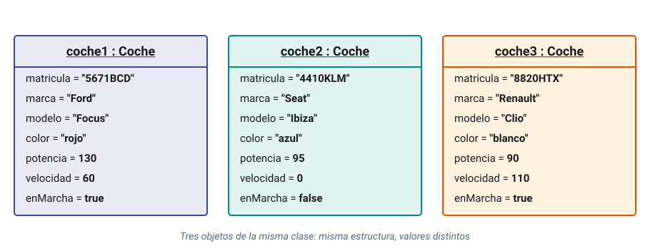
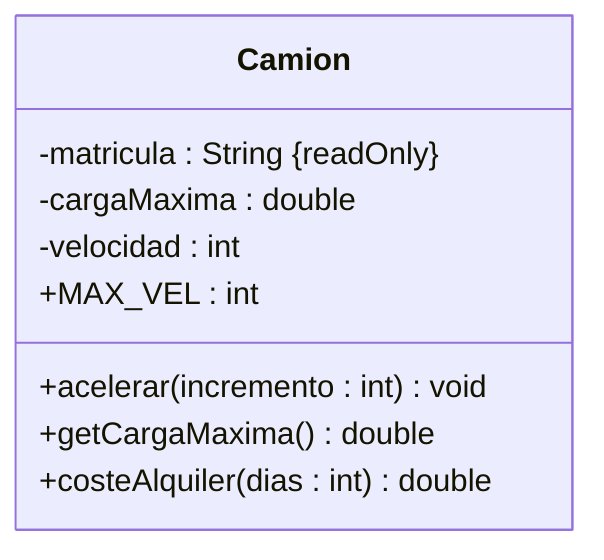
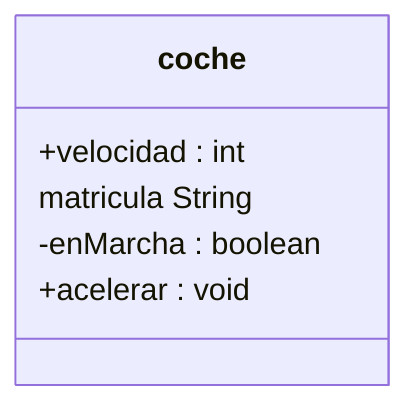

# 3. Clases y objetos en UML

El **diagrama de clases** es el diagrama más importante de UML y la base del resto: describe las clases de un sistema, lo que guardan, lo que pueden hacer y cómo se relacionan. En este capítulo aprenderás a dibujar y leer **una clase** y **un objeto**; en los siguientes, las relaciones entre ellos.

## 3.1. Lo que ya sabes de POO

En el [curso de POO](https://rlrprofe.github.io/poo/) viste que:

- Una **clase** es la plantilla que describe objetos con la misma estructura y comportamiento: sus **atributos** (lo que sabe) y sus **métodos** (lo que hace).
- Un **objeto** es una instancia de una clase, con su propia identidad y con valores concretos en sus atributos.
- Los atributos suelen ser **privados** y los servicios, **públicos** (encapsulación).

UML da una forma estándar de **dibujar** todo eso. Usaremos la clase `Coche` del primer capítulo de POO.

## 3.2. La clase en UML

Una clase se dibuja como un **rectángulo dividido en tres compartimentos**:

| Compartimento | Contiene | Ejemplo |
|---|---|---|
| **Superior** | El **nombre** de la clase | `Coche` |
| **Central** | Los **atributos** | `-velocidad : int` |
| **Inferior** | Las **operaciones** (métodos) | `+acelerar(incremento : int) : void` |

=== "Diagrama"

    ```mermaid
    classDiagram
        class Coche {
            -totalCoches : int$
            -matricula : String
            -marca : String
            -modelo : String
            -color : String
            -potencia : int
            -velocidad : int
            -enMarcha : boolean
            +ponerEnMarcha() void
            +parar() void
            +acelerar(incremento : int) void
            +frenar(decremento : int) void
            +getVelocidad() int
            +pintar(color : String) void
            +getTotalCoches() int$
        }
    ```

=== "PlantUML"

    ```text
    @startuml
    skinparam classAttributeIconSize 0

    class Coche {
      - {static} totalCoches : int
      - matricula : String
      - marca : String
      - modelo : String
      - color : String
      - potencia : int
      - velocidad : int
      - enMarcha : boolean
      + ponerEnMarcha() : void
      + parar() : void
      + acelerar(incremento : int) : void
      + frenar(decremento : int) : void
      + getVelocidad() : int
      + pintar(color : String) : void
      + {static} getTotalCoches() : int
    }
    @enduml
    ```

Reglas del **nombre**:

- Empieza por **mayúscula** y suele escribirse en singular y en formato *CamelCase*: `Coche`, `PlazaGaraje`.
- Es un **sustantivo** que identifica un concepto del problema, no una acción (`Coche`, no `Conducir`).
- Debe ser el mismo que se usará en el código.

## 3.3. Atributos

Un atributo se escribe con esta sintaxis; solo son obligatorios el nombre y, en la práctica, el tipo:

```text
visibilidad nombre : tipo [multiplicidad] = valorInicial {propiedades}
```

| Parte | Significado | Ejemplo |
|---|---|---|
| **visibilidad** | Quién puede acceder (`+ - # ~`, ver [3.5](#35-visibilidad)) | `-` |
| **nombre** | Identificador, en *camelCase* | `velocidad` |
| **tipo** | Tipo de dato | `int`, `String`, `double`, `boolean` |
| **multiplicidad** | Cuántos valores guarda (opcional) | `[0..*]` |
| **valorInicial** | Valor con el que nace (opcional) | `= 0` |
| **propiedades** | Condiciones entre llaves (opcional) | `{readOnly}` |

Algunos ejemplos de la clase `Coche`:

| Atributo en UML | Se lee como… | Java |
|---|---|---|
| `-velocidad : int = 0` | Atributo privado entero que empieza en 0 | `private int velocidad = 0;` |
| `-matricula : String {readOnly}` | Atributo privado que no cambia tras asignarse | `private final String matricula;` |
| `-totalCoches : int` (subrayado) | Atributo **de clase**: uno para todos los coches | `private static int totalCoches;` |
| `+VELOCIDAD_MAXIMA : int = 220 {readOnly}` | Constante pública | `public static final int VELOCIDAD_MAXIMA = 220;` |

!!! note "Atributos de clase y constantes"
    En UML los miembros `static` se escriben **subrayados**. Las constantes se marcan con `{readOnly}` (y por convención con el nombre en MAYÚSCULAS).

!!! tip "Atributos y relaciones"
    Un atributo cuyo tipo es **otra clase del modelo** (por ejemplo, `Alquiler` tiene un `Vehiculo`) normalmente **no se escribe como atributo**: se dibuja como una **relación** entre las dos clases. Lo verás en el capítulo 5.

## 3.4. Operaciones

Una operación (el método, visto desde el diseño) se escribe así:

```text
visibilidad nombre(parámetro : tipo, ...) : tipoDeRetorno
```

| Operación en UML | Se lee como… | Java |
|---|---|---|
| `+acelerar(incremento : int) : void` | Pública, recibe un entero y no devuelve nada | `public void acelerar(int incremento)` |
| `+getVelocidad() : int` | Pública, sin parámetros, devuelve un entero | `public int getVelocidad()` |
| `+pintar(color : String) : void` | Pública, recibe un texto | `public void pintar(String color)` |
| `+getTotalCoches() : int` (subrayada) | Operación **de clase** | `public static int getTotalCoches()` |

Algunas convenciones útiles:

- **Los constructores** se pueden omitir o escribirse como `+Coche(matricula : String, ...)`. Muchos diagramas los omiten porque se deducen.
- **Los getters y setters** suelen omitirse cuando no aportan información (a menudo se dibujan solo si son relevantes para el diseño).
- Una **operación abstracta** se escribe en *cursiva* (lo verás en el capítulo 7).
- Si el método **no devuelve nada**, se indica `void` (o se omite el tipo de retorno).

## 3.5. Visibilidad

La visibilidad indica **quién puede acceder** a un atributo u operación. Se escribe con un símbolo delante del nombre:

| Símbolo | Visibilidad | Quién accede | Java |
|:---:|---|---|---|
| `+` | **Pública** | Cualquier clase | `public` |
| `-` | **Privada** | Solo la propia clase | `private` |
| `#` | **Protegida** | La clase, su paquete y sus subclases | `protected` |
| `~` | **De paquete** | Las clases del mismo paquete | *(sin modificador)* |

La regla habitual en diseño: **atributos privados (`-`) y operaciones públicas (`+`)**, como pide la encapsulación. Si en un diagrama ves un atributo público (`+velocidad : int`), conviene preguntarse si es intencionado.

## 3.6. Niveles de detalle

Un diagrama **no tiene por qué mostrarlo todo**. Según para qué lo uses, enseñarás más o menos información de cada clase:

=== "Solo el nombre"

    Vista general del sistema: qué clases hay.

    ```mermaid
    classDiagram
        class Coche
    ```

=== "Nombre y atributos"

    Qué datos guarda cada clase.

    ```mermaid
    classDiagram
        class Coche {
            -matricula : String
            -marca : String
            -modelo : String
            -velocidad : int
            -enMarcha : boolean
        }
    ```

=== "Completa"

    Diseño detallado, listo para implementar.

    ```mermaid
    classDiagram
        class Coche {
            -matricula : String
            -marca : String
            -modelo : String
            -velocidad : int
            -enMarcha : boolean
            +ponerEnMarcha() void
            +parar() void
            +acelerar(incremento : int) void
            +frenar(decremento : int) void
            +getVelocidad() int
        }
    ```

!!! tip "Regla práctica"
    Muestra solo lo necesario para que el diagrama cumpla su función. Un boceto para discutir con el equipo no necesita cada getter; un diagrama de diseño para otro programador, sí necesita los tipos y las visibilidades.

## 3.7. De Java a UML (y de vuelta)

Con la notación anterior, pasar de una clase Java a su cuadro UML es casi mecánico. Este es un resumen de la clase `Coche`:

=== "Java"

    ```java
    public class Coche {
        private static int totalCoches = 0;
        private final String matricula;
        private int velocidad;
        private boolean enMarcha;

        public Coche(String matricula, String marca, String modelo,
                     String color, int potencia) { /* ... */ }

        public void acelerar(int incremento) { /* ... */ }
        public int getVelocidad() { /* ... */ }
        public static int getTotalCoches() { /* ... */ }
    }
    ```

=== "UML"

    ```mermaid
    classDiagram
        class Coche {
            -totalCoches : int$
            -matricula : String #123;readOnly#125;
            -velocidad : int
            -enMarcha : boolean
            +acelerar(incremento : int) void
            +getVelocidad() int
            +getTotalCoches() int$
        }
    ```

| En Java | En UML |
|---|---|
| Nombre de la clase | Compartimento superior |
| Campos (`private int velocidad;`) | Compartimento central: `-velocidad : int` |
| Métodos | Compartimento inferior: `+acelerar(incremento : int) : void` |
| `private` / `public` / `protected` | `-` / `+` / `#` |
| El tipo **antes** del nombre (`int velocidad`) | El tipo **después**, tras dos puntos (`velocidad : int`) |
| `static` | Subrayado |
| `final` | `{readOnly}` |

!!! warning "Un detalle de orden"
    En Java el tipo va **antes** del nombre; en UML, **después** y separado por dos puntos. Es el error de notación más frecuente al empezar.

## 3.8. Interpretar una clase

Para **leer** una clase dibujada, recórrela en este orden:

1. **Nombre**: ¿qué concepto representa?
2. **Atributos**: ¿qué datos guarda y de qué tipo? ¿Alguno es de clase o constante?
3. **Operaciones**: ¿qué servicios ofrece? ¿Cuáles son públicos y cuáles internos?
4. **Visibilidad**: ¿respeta la encapsulación (atributos privados)?

Aplicado a `Coche`: es un concepto de la empresa de alquiler; guarda matrícula, marca, modelo, color, potencia, velocidad y si está en marcha, además de un contador de coches creados compartido por todos; ofrece operaciones para ponerlo en marcha, pararlo, acelerarlo, frenarlo, consultarlo y pintarlo; y respeta la encapsulación porque todos los atributos son privados.

## 3.9. Objetos e instanciación

Una clase es la plantilla; los **objetos** son las cosas concretas que se crean a partir de ella (instanciación, con `new` en Java). UML también sabe dibujarlos, con el **diagrama de objetos**: una «fotografía» de los objetos de un sistema en un instante dado, con los valores que tienen en ese momento.

### Notación de un objeto

- Se dibuja como un rectángulo con **dos compartimentos**.
- El nombre se escribe **subrayado** con la forma `nombreObjeto : NombreClase`.
- En el segundo compartimento aparecen los **atributos con su valor** actual (`atributo = valor`).

Si el nombre del objeto no importa, se puede escribir solo `: Coche` (objeto anónimo).

Este diagrama muestra el resultado de ejecutar el `PruebaCoches` del curso de POO, con tres coches de la misma clase:



=== "Java"

    ```java
    Coche coche1 = new Coche("5671BCD", "Ford", "Focus", "rojo", 130);
    Coche coche2 = new Coche("4410KLM", "Seat", "Ibiza", "azul", 95);
    Coche coche3 = new Coche("8820HTX", "Renault", "Clio", "blanco", 90);

    coche1.ponerEnMarcha();
    coche1.acelerar(60);
    coche3.ponerEnMarcha();
    coche3.acelerar(110);
    ```

=== "PlantUML"

    ```text
    @startuml
    object "coche1 : Coche" as coche1 {
      matricula = "5671BCD"
      marca = "Ford"
      modelo = "Focus"
      color = "rojo"
      potencia = 130
      velocidad = 60
      enMarcha = true
    }
    object "coche2 : Coche" as coche2 {
      matricula = "4410KLM"
      marca = "Seat"
      modelo = "Ibiza"
      color = "azul"
      potencia = 95
      velocidad = 0
      enMarcha = false
    }
    @enduml
    ```

Fíjate en cómo se relacionan el diagrama de clases y el de objetos:

| | Diagrama de **clases** | Diagrama de **objetos** |
|---|---|---|
| Describe | La **plantilla**: estructura general | Objetos **concretos** en un instante |
| Atributos | Nombre y tipo (`velocidad : int`) | Nombre y **valor** (`velocidad = 60`) |
| Nombre | `Coche` | `coche1 : Coche` (subrayado) |
| Es válido… | Siempre | Solo en ese momento |
| Sirve para | Diseñar el sistema | Ilustrar un ejemplo, explicar un estado, depurar |

Cuando haya relaciones entre clases (capítulo 5), el diagrama de objetos mostrará también los **enlaces** entre los objetos concretos.

## Resumen del capítulo

- Una **clase** se dibuja con tres compartimentos: nombre, atributos y operaciones.
- Atributo: `visibilidad nombre : tipo = valorInicial {propiedades}`. Operación: `visibilidad nombre(parámetros) : tipoRetorno`.
- Visibilidad: `+` pública, `-` privada, `#` protegida, `~` de paquete. Lo habitual: atributos privados y operaciones públicas.
- Lo **estático** se subraya y las constantes se marcan con `{readOnly}`.
- El nivel de detalle depende de la **finalidad** del diagrama.
- Un **objeto** se dibuja como `nombre : Clase` (subrayado) con los **valores** de sus atributos: es un diagrama de objetos, una fotografía de un instante.

## Actividades

**Actividad 1.** Interpreta este diagrama y responde:



1. ¿Cuántos atributos tiene y cuántos son privados?
2. ¿Hay algún atributo que no respete la encapsulación?
3. ¿Qué atributo no puede cambiar una vez asignado?
4. ¿Qué operación devuelve un número decimal y qué recibe?
5. ¿Cómo se escribiría `getCargaMaxima` en Java?

??? success "Solución"
    1. **Cuatro** atributos; **tres** son privados (`matricula`, `cargaMaxima`, `velocidad`).
    2. Sí: `+MAX_VEL : int` es **público**. Sería aceptable si fuera una constante, pero no está marcada como `{readOnly}`, así que conviene revisarlo.
    3. `matricula`, por tener `{readOnly}`.
    4. `costeAlquiler`, que recibe un entero `dias` y devuelve un `double`.
    5. `public double getCargaMaxima()`.

**Actividad 2.** Dibuja el diagrama de la siguiente clase Java (en draw.io o con PlantUML):

```java
public class PlazaGaraje {
    private final String codigo;
    private boolean ocupada;

    public PlazaGaraje(String codigo) { /* ... */ }

    public String getCodigo() { /* ... */ }
    public boolean isOcupada() { /* ... */ }
    public void ocupar() { /* ... */ }
    public double costeAlquiler(int dias) { /* ... */ }
}
```

??? success "Solución"
    ```text
    @startuml
    skinparam classAttributeIconSize 0

    class PlazaGaraje {
      - codigo : String {readOnly}
      - ocupada : boolean
      + getCodigo() : String
      + isOcupada() : boolean
      + ocupar() : void
      + costeAlquiler(dias : int) : double
    }
    @enduml
    ```

    El resultado equivale a:

    ```mermaid
    classDiagram
        class PlazaGaraje {
            -codigo : String #123;readOnly#125;
            -ocupada : boolean
            +getCodigo() String
            +isOcupada() boolean
            +ocupar() void
            +costeAlquiler(dias : int) double
        }
    ```

    El constructor se ha omitido, como es habitual.

**Actividad 3.** Dibuja el diagrama de objetos que resulta de ejecutar este código, con los valores de los atributos de cada objeto (`matricula`, `color`, `velocidad`, `enMarcha`):

```java
Coche a = new Coche("5671BCD", "Ford", "Focus", "rojo", 130);
Coche b = new Coche("4410KLM", "Seat", "Ibiza", "azul", 95);
a.ponerEnMarcha();
a.acelerar(60);
b.pintar("verde");
```

??? success "Solución"
    ```text
    @startuml
    object "a : Coche" as a {
      matricula = "5671BCD"
      color = "rojo"
      velocidad = 60
      enMarcha = true
    }
    object "b : Coche" as b {
      matricula = "4410KLM"
      color = "verde"
      velocidad = 0
      enMarcha = false
    }
    @enduml
    ```

    El objeto `a` está en marcha a 60 km/h; el objeto `b` sigue parado, pero ha cambiado de color. Son dos objetos de la misma clase con **estados distintos**.

**Actividad 4.** Este diagrama contiene **cuatro errores** de notación o de diseño. Encuéntralos y corrígelos:



??? success "Solución"
    1. **El nombre de la clase** debe empezar por mayúscula: `Coche`.
    2. **`+velocidad : int`** es un atributo público, lo que rompe la encapsulación: debe ser `-velocidad : int`.
    3. **`matricula String`** no sigue la notación UML: falta la visibilidad y los dos puntos. Correcto: `-matricula : String`.
    4. **`+acelerar : void`** parece un atributo porque le faltan los paréntesis y el parámetro. Correcto: `+acelerar(incremento : int) : void`.

    Diagrama corregido:

    ```mermaid
    classDiagram
        class Coche {
            -velocidad : int
            -matricula : String
            -enMarcha : boolean
            +acelerar(incremento : int) void
        }
    ```
