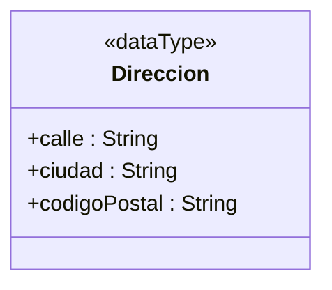
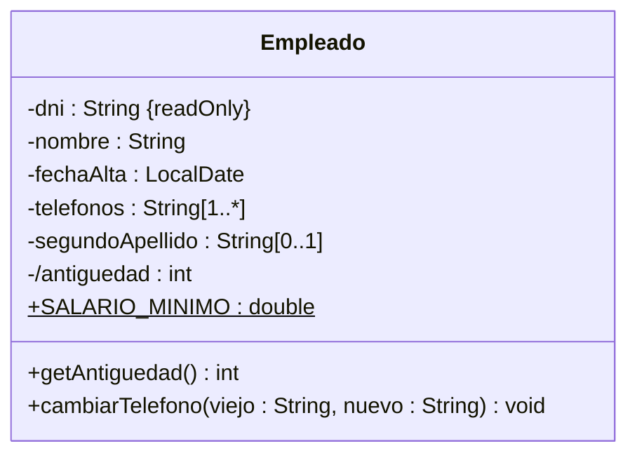
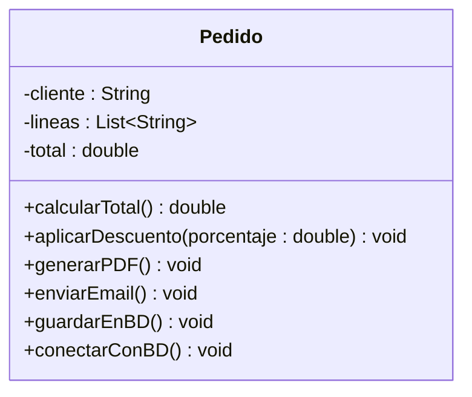

# 4. Atributos, operaciones y tipos en detalle

En el capítulo 3 aprendiste a dibujar una clase con sus atributos y operaciones básicos. Ese nivel basta para un boceto, pero cuando el diagrama se usa para **diseñar** o para **generar código** hay que ser más preciso: ¿el atributo es opcional?, ¿se guarda o se calcula?, ¿qué valores admite?, ¿qué parámetros recibe la operación? En este capítulo aprenderás la notación que responde a esas preguntas y, sobre todo, a **decidir qué debe llevar cada clase**.

## 4.1. Multiplicidad de un atributo

A un atributo se le puede indicar **cuántos valores guarda** escribiendo la multiplicidad entre corchetes después del tipo:

```text
visibilidad nombre : tipo [multiplicidad]
```

| Multiplicidad | Significado | Ejemplo |
|---|---|---|
| `[1]` | Exactamente un valor (es lo habitual y **no se escribe**) | `-dni : String` |
| `[0..1]` | **Opcional**: puede no tener valor | `-email : String [0..1]` |
| `[*]` o `[0..*]` | Cero o más valores | `-observaciones : String [0..*]` |
| `[1..*]` | **Al menos uno** | `-telefonos : String [1..*]` |
| `[3]` | Un número exacto | `-coordenadas : double [3]` |

En el curso de POO, el conductor de la empresa de alquiler solo tenía DNI y nombre. Ampliémoslo para ver estas notaciones:

=== "Diagrama"

    ```mermaid
    classDiagram
        class Conductor {
            -dni : String
            -nombre : String
            -fechaNacimiento : LocalDate
            -telefonos : String[1..*]
            -email : String[0..1]
            +getEdad() int
        }
    ```

=== "PlantUML"

    ```text
    @startuml
    skinparam classAttributeIconSize 0

    class Conductor {
      - dni : String
      - nombre : String
      - fechaNacimiento : LocalDate
      - telefonos : String [1..*]
      - email : String [0..1]
      + getEdad() : int
    }
    @enduml
    ```

Así se traduce a Java:

```java
public class Conductor {
    private String dni;                          // [1]: obligatorio
    private String nombre;
    private LocalDate fechaNacimiento;
    private List<String> telefonos = new ArrayList<>();   // [1..*]: colección
    private String email;                        // [0..1]: puede ser null

    public int getEdad() { /* ... */ }
}
```

- Una multiplicidad **superior a uno** se traduce en una **colección** (`List`) o en un array.
- Una multiplicidad **`[0..1]`** se traduce en un atributo que **puede valer `null`** (o en un `Optional`). Marcarlo en el diagrama avisa al programador de que debe comprobarlo.

## 4.2. Atributos derivados

Un atributo es **derivado** cuando su valor **se calcula** a partir de otros atributos, en lugar de guardarse. Se marca con una **barra** (`/`) delante del nombre.

El conductor tiene `fechaNacimiento`; su **edad** no hace falta guardarla porque se obtiene de la fecha y de la fecha actual:

```text
/edad : int
```

=== "Diagrama"

    ```mermaid
    classDiagram
        class Conductor {
            -fechaNacimiento : LocalDate
            -/edad : int
        }
        class Alquiler {
            -dias : int
            -/total : double
        }
    ```

=== "PlantUML"

    ```text
    @startuml
    skinparam classAttributeIconSize 0

    class Conductor {
      - fechaNacimiento : LocalDate
      - /edad : int
    }
    class Alquiler {
      - dias : int
      - /total : double
    }
    @enduml
    ```

=== "Java"

    ```java
    public class Conductor {
        private LocalDate fechaNacimiento;

        // /edad no es un campo: se calcula cada vez
        public int getEdad() {
            return Period.between(fechaNacimiento, LocalDate.now()).getYears();
        }
    }
    ```

!!! tip "¿Por qué no guardar la edad?"
    Un dato calculado y guardado **se queda desfasado**: la edad guardada hoy es incorrecta el día del cumpleaños. Lo mismo ocurre con el `total` de un alquiler: depende del vehículo, de los días y de los extras, y por eso `Alquiler.getTotal()` lo calcula cada vez. Marcar `/total` en el diagrama dice «esto se calcula, no se almacena».

## 4.3. Elementos de clase y constantes

Ya sabes que lo **estático** se subraya (en Mermaid y PlantUML se marca con `$` y `{static}`). Dos casos muy frecuentes:

- **Contador compartido** por todos los objetos: `-totalCoches : int` (estático).
- **Constante**: un valor que **no cambia** nunca. Es estático y de solo lectura: `{readOnly}`.

=== "Diagrama"

    ```mermaid
    classDiagram
        class Coche {
            +MAX_PLAZAS : int$
            -totalCoches : int$
            -plazas : int
            +getTotalCoches() int$
        }
    ```

=== "PlantUML"

    ```text
    @startuml
    skinparam classAttributeIconSize 0

    class Coche {
      + {static} MAX_PLAZAS : int {readOnly}
      - {static} totalCoches : int
      - plazas : int
      + {static} getTotalCoches() : int
    }
    @enduml
    ```

=== "Java"

    ```java
    public class Coche {
        public static final int MAX_PLAZAS = 9;   // constante: static + final
        private static int totalCoches;           // contador compartido
        private int plazas;

        public static int getTotalCoches() { return totalCoches; }
    }
    ```

!!! note "Constante = `static` + `final`"
    En Java, `final` es `{readOnly}` en UML. Una constante se escribe en MAYÚSCULAS (`MAX_PLAZAS`). Una constante pública es aceptable porque nadie puede modificarla; un atributo público **modificable** rompe la encapsulación.

## 4.4. Tipos de los atributos

El tipo que se escribe tras los dos puntos puede ser de varias clases. Lo importante es saber **dónde** dibujar cada uno:

| Tipo del atributo | Ejemplo | Cómo se dibuja |
|---|---|---|
| **Primitivo** | `int`, `double`, `boolean` | Atributo: `-velocidad : int` |
| **Clase de la biblioteca del lenguaje** (valores) | `String`, `LocalDate`, `BigDecimal` | Atributo: `-nombre : String` |
| **Enumeración** | `Combustible` | Atributo con ese tipo (apartado 4.5) |
| **Otra clase del modelo** | `Vehiculo`, `Conductor` | **Relación** entre clases (capítulo 5), no atributo |
| **Colección de objetos del modelo** | `List<Extra>` | **Relación** con multiplicidad `*` (capítulo 5) |

!!! warning "Error muy frecuente"
    Escribir `-vehiculo : Vehiculo` dentro de `Alquiler` **y además** dibujar la línea entre ambas clases es contar lo mismo dos veces. Si el tipo es una clase de tu modelo, se dibuja **solo la relación**. En Java sí será un campo (`private Vehiculo vehiculo;`), pero el diagrama lo expresa con una línea.

UML define sus propios tipos básicos (`Integer`, `Real`, `Boolean`, `String`), pero en la práctica se escriben los **tipos del lenguaje** en el que se va a programar (`int`, `double`…), como hacemos en este curso.

Cuando un tipo es **genérico** se indica entre ángulos (`List<String>`), y Mermaid lo escribe con tildes (`List~String~`). Sin embargo, es más claro usar la multiplicidad (`String [0..*]`), que no depende del lenguaje.

## 4.5. Enumeraciones y tipos de dato

### Enumeraciones

Una **enumeración** es un tipo con un conjunto **fijo y cerrado** de valores. Se dibuja como una clase con el estereotipo `<<enumeration>>` y los valores (literales) en el compartimento central. Imaginemos que la empresa clasifica sus vehículos por tipo de combustible:

=== "Diagrama"

    ```mermaid
    classDiagram
        class Combustible {
            <<enumeration>>
            GASOLINA
            DIESEL
            ELECTRICO
            HIBRIDO
        }
        class Coche {
            -matricula : String
            -combustible : Combustible
        }
        Coche ..> Combustible
    ```

=== "PlantUML"

    ```text
    @startuml
    skinparam classAttributeIconSize 0

    enum Combustible {
      GASOLINA
      DIESEL
      ELECTRICO
      HIBRIDO
    }
    class Coche {
      - matricula : String
      - combustible : Combustible
    }
    Coche ..> Combustible
    @enduml
    ```

=== "Java"

    ```java
    public enum Combustible {
        GASOLINA, DIESEL, ELECTRICO, HIBRIDO
    }

    public class Coche {
        private String matricula;
        private Combustible combustible;
    }
    ```

Es una buena opción cuando los valores posibles son **pocos, fijos y sin comportamiento propio** (combustible, estado de un alquiler, día de la semana). Si cada valor necesitara sus propios datos o métodos distintos, probablemente sea mejor una jerarquía de clases (capítulo 7).

### Tipos de dato

Un **tipo de dato** (`<<dataType>>`) es un conjunto de valores **sin identidad propia**: dos direcciones con la misma calle, ciudad y código postal son «la misma» dirección. A diferencia de una clase, lo que importa es el valor, no el objeto. Ejemplos: `Direccion`, `Dinero`, `Fecha`.



En Java se suele implementar como una clase inmutable o como un `record`.

## 4.6. Operaciones en detalle

La sintaxis completa de una operación es:

```text
visibilidad nombre(dirección parámetro : tipo = valorPorDefecto, ...) : tipoRetorno {propiedades}
```

### Parámetros

- **Dirección**: `in` (entrada, la opción por defecto y que no se escribe), `out` (salida) e `inout` (entrada y salida). En Java todos los parámetros son de entrada, así que casi siempre se omite.
- **Valor por defecto**: `acelerar(incremento : int = 10)`. Java no tiene valores por defecto en los parámetros, así que se traduce con **sobrecarga**.

### Sobrecarga

Varias operaciones pueden tener **el mismo nombre con distintos parámetros**:

=== "Diagrama"

    ```mermaid
    classDiagram
        class Vehiculo {
            +acelerar() void
            +acelerar(incremento : int) void
            +pintar(color : String) void
        }
    ```

=== "Java"

    ```java
    public void acelerar() {
        acelerar(10);              // valor por defecto: 10 km/h
    }

    public void acelerar(int incremento) { /* ... */ }
    ```

### Constructores

El constructor se escribe con el **nombre de la clase** y, si se quiere resaltar, con el estereotipo `<<create>>`. Como no devuelve nada, no lleva tipo de retorno:

```text
+<<create>> Coche(matricula : String, marca : String, modelo : String, color : String, potencia : int)
```

En los diagramas de diseño suele **omitirse**, igual que los *getters* y *setters* triviales, porque saturan el dibujo sin aportar información. Se muestran cuando son relevantes (por ejemplo, un constructor con una validación importante).

### Operaciones de consulta

Una operación marcada con `{query}` **no modifica el estado** del objeto: solo lo consulta. Es el caso de `getVelocidad()` o de `getTotal()`. Java no tiene una palabra equivalente, pero la propiedad documenta una garantía útil para quien usa la clase.

```text
+getTotal() : double {query}
```

### ¿Se dibujan todos los getters y setters?

| Contexto del diagrama | ¿Mostrar *getters/setters*? |
|---|---|
| **Boceto** o análisis (qué clases hay) | No |
| **Diseño** (cómo será la clase) | Solo los que forman parte del servicio |
| **Documentación de una API pública** | Sí, todas las operaciones públicas |
| **Ingeniería inversa** (la herramienta los genera) | Suelen aparecer todos: conviene filtrarlos |

## 4.7. Propiedades y restricciones

Entre **llaves** se pueden añadir a un atributo, a una operación o a una clase:

- **Propiedades** predefinidas: `{readOnly}` (no cambia después de asignarse), `{unique}` (sin repetidos), `{ordered}` (mantiene el orden), `{id}` (identifica al objeto), `{query}`.
- **Restricciones**: una condición que **siempre debe cumplirse**, escrita en lenguaje natural o en un lenguaje formal (OCL, que no veremos): `{potencia > 0}`.

Las restricciones largas se colocan en una **nota** conectada por una línea discontinua al elemento afectado:

=== "Diagrama"

    ```mermaid
    classDiagram
        class Vehiculo {
            -matricula : String #123;readOnly#125;
            -potencia : int
            -velocidad : int
        }
        note for Vehiculo "La potencia debe ser positiva. La velocidad nunca supera la velocidad máxima."
    ```

=== "PlantUML"

    ```text
    @startuml
    skinparam classAttributeIconSize 0

    class Vehiculo {
      - matricula : String {readOnly}
      - potencia : int
      - velocidad : int
    }
    note right of Vehiculo
      {potencia > 0}
      {velocidad <= velocidad máxima}
    end note
    @enduml
    ```

=== "Java"

    ```java
    public Vehiculo(String matricula, String marca, String modelo,
                    String color, int potencia) {
        if (potencia <= 0) {                       // restricción {potencia > 0}
            throw new IllegalArgumentException("La potencia debe ser positiva");
        }
        this.matricula = matricula;                // {readOnly}: el campo es final
        // ...
    }
    ```

Las restricciones son la parte del diagrama que **más se olvida** y la que más errores evita: convierten una regla del enunciado (la potencia es siempre positiva) en un requisito visible para quien programa.

## 4.8. ¿Qué debe llevar una clase? Cohesión y responsabilidad

Saber dibujar una clase es la mitad del trabajo; la otra mitad es **decidir qué incluir**. El criterio principal es la **responsabilidad única**: una clase debe representar **un solo concepto** y tener **una sola razón para cambiar**. Cuando una clase hace de todo (se la llama a veces «clase Dios») es difícil de entender, de probar y de modificar.

=== "Mal diseño"

    ```mermaid
    classDiagram
        class Alquiler {
            -vehiculo : Vehiculo
            -dias : int
            +getTotal() double
            +imprimirFactura() void
            +enviarFacturaPorEmail(email : String) void
            +guardarEnBaseDeDatos() void
        }
    ```

=== "Mejor diseño"

    ```mermaid
    classDiagram
        class Alquiler {
            -dias : int
            +getTotal() double
        }
        class Factura {
            +imprimir() void
            +enviarPorEmail(email : String) void
        }
        class AlquilerRepositorio {
            +guardar(alquiler : Alquiler) void
        }
        Factura ..> Alquiler
        AlquilerRepositorio ..> Alquiler
    ```

Un **alquiler** sabe calcular su importe; **imprimir** o **enviar** una factura y **guardar** en una base de datos son responsabilidades distintas que probablemente cambien por motivos distintos. Al separarlas, un cambio en el formato de la factura no obliga a tocar la clase `Alquiler`.

Preguntas para comprobar la **cohesión** de una clase:

1. ¿Puedo describir su propósito en **una frase sin «y»**?
2. ¿Todas sus operaciones **usan sus atributos**, o hay operaciones que no tienen nada que ver con ellos?
3. ¿Su nombre es un **sustantivo claro** del problema (`Alquiler`) y no algo vago (`Gestor`, `Manager`, `Datos`)?
4. ¿Tiene **demasiados** atributos o métodos para caber en un compartimento legible?

!!! info "Lo opuesto: clases anémicas"
    El exceso contrario también es un problema: clases que solo tienen atributos y *getters/setters* y ninguna lógica, mientras otra clase hace todos los cálculos. La idea de la orientación a objetos es que cada clase **cuide sus propios datos y ofrezca las operaciones que los manejan**.

## 4.9. La notación de una clase de un vistazo

| Elemento | Notación | Ejemplo |
|---|---|---|
| Atributo | `vis nombre : tipo [mult] = valor {prop}` | `-telefonos : String [1..*]` |
| Atributo opcional | `[0..1]` | `-email : String [0..1]` |
| Atributo derivado | `/nombre` | `/edad : int` |
| Constante | estático + `{readOnly}` | `+MAX_PLAZAS : int` |
| Operación | `vis nombre(par : tipo) : retorno` | `+acelerar(incremento : int) : void` |
| Operación de consulta | `{query}` | `+getTotal() : double {query}` |
| Constructor | `<<create>>` o nombre de la clase | `+Coche(matricula : String)` |
| Enumeración | `<<enumeration>>` + literales | `Combustible` |
| Tipo de dato | `<<dataType>>` | `Direccion` |
| Restricción | `{condición}` o nota | `{potencia > 0}` |

## Resumen del capítulo

- Un atributo puede indicar su **multiplicidad** (`[0..1]` opcional, `[1..*]` al menos uno, `[*]` cualquier número).
- Un atributo **derivado** (`/edad`) se calcula a partir de otros: no se guarda.
- Una **constante** es estática y de solo lectura (`static final` en Java).
- Si el tipo es una **clase del modelo**, se dibuja una **relación**, no un atributo.
- Las **enumeraciones** (`<<enumeration>>`) modelan conjuntos fijos de valores; los **tipos de dato** (`<<dataType>>`), valores sin identidad.
- Las operaciones pueden llevar **parámetros con dirección y valor por defecto**, **sobrecarga**, y marcarse como `{query}`.
- Las **restricciones** entre llaves o en notas recogen las reglas que el objeto siempre debe cumplir.
- Una clase debe tener **una sola responsabilidad** y alta **cohesión**.

## Actividades

**Actividad 1.** Interpreta esta clase y responde:



1. ¿Qué atributos son obligatorios y cuáles opcionales?
2. ¿Cuántos teléfonos puede tener un empleado como mínimo?
3. ¿Se guarda la antigüedad? ¿Por qué?
4. ¿Qué significa que `SALARIO_MINIMO` sea estático? ¿Debería llevar alguna propiedad más?
5. Escribe los atributos del empleado en Java.

??? success "Solución"
    1. Opcional: solo `segundoApellido` (`[0..1]`). El resto son obligatorios (`[1]` implícito); `telefonos` además admite varios valores.
    2. **Uno** como mínimo (`[1..*]`).
    3. **No** se guarda: `/antiguedad` es derivado y se calcula a partir de `fechaAlta`.
    4. Es un valor **compartido por todos** los empleados (pertenece a la clase). Al ser una constante, debería marcarse también como `{readOnly}` y llamarse en mayúsculas, como ya está.
    5. ```java
       private final String dni;
       private String nombre;
       private LocalDate fechaAlta;
       private List<String> telefonos = new ArrayList<>();
       private String segundoApellido;            // puede ser null
       // antiguedad: no es campo, se calcula en getAntiguedad()
       public static final double SALARIO_MINIMO = 1134.0;
       ```

**Actividad 2.** Una biblioteca guarda de cada **socio**: su número de socio (no cambia nunca), nombre, fecha de nacimiento, al menos un teléfono, un correo electrónico (opcional), y su **tipo de cuota** (que solo puede ser `INFANTIL`, `ADULTO` o `JUBILADO`). Se necesita conocer su edad. Dibuja la clase `Socio` y lo que haga falta para el tipo de cuota.

??? success "Solución"
    ```mermaid
    classDiagram
        class TipoCuota {
            <<enumeration>>
            INFANTIL
            ADULTO
            JUBILADO
        }
        class Socio {
            -numeroSocio : int #123;readOnly#125;
            -nombre : String
            -fechaNacimiento : LocalDate
            -telefonos : String[1..*]
            -email : String[0..1]
            -cuota : TipoCuota
            -/edad : int
            +getEdad() int
        }
        Socio ..> TipoCuota
    ```

    - El número de socio es `{readOnly}` porque «no cambia nunca».
    - `email` es `[0..1]` (opcional) y `telefonos` es `[1..*]` (al menos uno).
    - La **edad** se pide pero es derivada de la fecha de nacimiento: `/edad`.
    - Los tres tipos de cuota forman un conjunto cerrado: **enumeración**.

**Actividad 3.** Dibuja el diagrama de esta clase Java:

```java
public class Cuenta {
    public static final double COMISION = 1.5;
    private static int numCuentas;

    private final String iban;
    private double saldo;
    private List<String> titulares = new ArrayList<>();

    public Cuenta(String iban) { /* ... */ }

    public void ingresar(double cantidad) { /* ... */ }
    public void ingresar(double cantidad, String concepto) { /* ... */ }
    public double getSaldo() { /* ... */ }
    public static int getNumCuentas() { /* ... */ }
}
```

??? success "Solución"
    ```text
    @startuml
    skinparam classAttributeIconSize 0

    class Cuenta {
      + {static} COMISION : double {readOnly}
      - {static} numCuentas : int
      - iban : String {readOnly}
      - saldo : double
      - titulares : String [1..*]
      + <<create>> Cuenta(iban : String)
      + ingresar(cantidad : double) : void
      + ingresar(cantidad : double, concepto : String) : void
      + getSaldo() : double {query}
      + {static} getNumCuentas() : int
    }
    @enduml
    ```

    Detalles que suelen olvidarse: `COMISION` es constante (estática y `{readOnly}`), `iban` es `final` y por tanto `{readOnly}`, `ingresar` está **sobrecargada** (dos firmas) y `titulares` es una colección, que en UML se expresa con multiplicidad. (El `[1..*]` es una decisión de diseño: una cuenta debería tener al menos un titular.)

**Actividad 4.** Esta clase hace demasiadas cosas. Identifica las responsabilidades y propón un diseño mejor:



??? success "Solución"
    Responsabilidades mezcladas:

    1. **Pedido** (el concepto): cliente, líneas y cálculo del total y del descuento.
    2. **Presentación**: `generarPDF()`.
    3. **Comunicación**: `enviarEmail()`.
    4. **Persistencia**: `guardarEnBD()` y `conectarConBD()`.

    ```mermaid
    classDiagram
        class Pedido {
            -cliente : Cliente
            -/total : double
            +calcularTotal() double
            +aplicarDescuento(porcentaje : double) void
        }
        class LineaPedido {
            -producto : String
            -cantidad : int
            -precio : double
        }
        class GeneradorPDF {
            +generar(pedido : Pedido) void
        }
        class ServicioEmail {
            +enviar(pedido : Pedido) void
        }
        class PedidoRepositorio {
            +guardar(pedido : Pedido) void
        }
        GeneradorPDF ..> Pedido
        ServicioEmail ..> Pedido
        PedidoRepositorio ..> Pedido
    ```

    Además, `lineas : List<String>` mezclaba un tipo del modelo en un atributo: lo correcto es una clase `LineaPedido` y una **relación** (capítulo 5). Las líneas de puntos son **dependencias** (capítulo 6).
