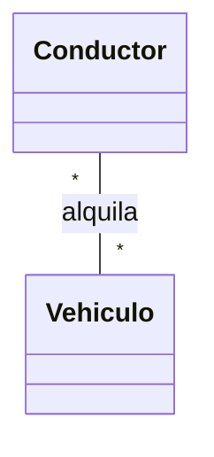
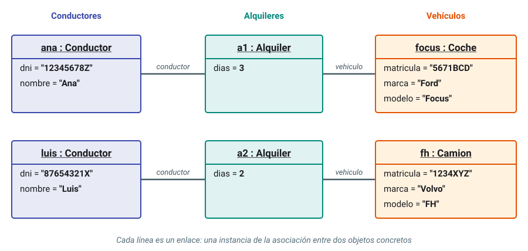
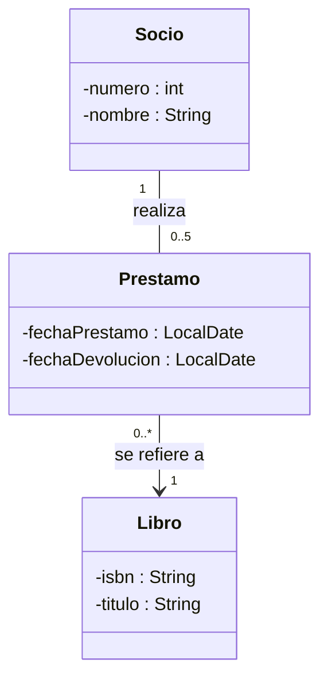

# 5. Asociaciones en profundidad

Las clases rara vez trabajan solas: un alquiler **necesita** un vehículo y un conductor; una flota **agrupa** vehículos. Estas conexiones se dibujan como **relaciones** y son, junto a las clases, lo que da sentido a un diagrama de clases. La relación más básica y más frecuente es la **asociación**, y en este capítulo la estudiamos con todo detalle: cómo se nombra, cuántos objetos conecta, hacia dónde se puede «navegar» y cómo se convierte en código.

## 5.1. ¿Qué es una asociación?

Una **asociación** indica que los objetos de una clase **están conectados** con objetos de otra, de modo que unos **conocen** a los otros y pueden enviarse mensajes. Se dibuja con una **línea continua** entre las dos clases.

Pensemos en la empresa de alquiler. Un alquiler tiene un conductor, y esa conexión es una asociación:

=== "Diagrama"

    ```mermaid
    classDiagram
        class Conductor {
            -dni : String
            -nombre : String
        }
        class Alquiler {
            -dias : int
        }
        Conductor -- Alquiler
    ```

=== "PlantUML"

    ```text
    @startuml
    skinparam classAttributeIconSize 0

    class Conductor {
      - dni : String
      - nombre : String
    }
    class Alquiler {
      - dias : int
    }
    Conductor -- Alquiler
    @enduml
    ```

La línea dice «están relacionados», pero todavía no dice **cómo** ni **cuántos**. Para ser útil, una asociación se completa con un **nombre**, **multiplicidades**, **roles** y **navegabilidad**, que veremos uno a uno.

!!! info "En el código"
    Una asociación entre `Alquiler` y `Conductor` se convierte en Java en **un atributo cuyo tipo es la otra clase**: `Alquiler` tendrá un campo `private Conductor conductor;`. Por eso en el capítulo 4 vimos que ese campo **no se dibuja como atributo**: ya lo expresa la línea.

## 5.2. Nombre de la asociación y sentido de lectura

Se le puede poner un **nombre** (normalmente un verbo) que explique el vínculo. Junto al nombre se añade un pequeño **triángulo** que indica en qué sentido se lee (en Mermaid se suele escribir el verbo; en PlantUML se puede añadir `>` o `<`).

```text
Conductor ── realiza ──▶ Alquiler        «Un conductor realiza alquileres»
```

=== "Diagrama"

    ```mermaid
    classDiagram
        Conductor -- Alquiler : realiza
        Alquiler -- Vehiculo : alquila
    ```

=== "PlantUML"

    ```text
    @startuml
    Conductor -- Alquiler : realiza >
    Alquiler -- Vehiculo : alquila >
    @enduml
    ```

Un buen nombre permite **leer el diagrama como frases**: «un conductor realiza alquileres», «un alquiler alquila un vehículo». Si el nombre es evidente (por ejemplo, «tiene»), se puede omitir; si no, **conviene escribirlo**.

!!! tip "Cómo elegir el nombre"
    Usa un **verbo en presente** que forme una frase con los nombres de las clases: `Médico — atiende — Paciente`, `Profesor — imparte — Asignatura`. Evita nombres vacíos como «se relaciona con» o «tiene a».

## 5.3. Multiplicidad

La **multiplicidad** (o cardinalidad) indica **cuántos objetos** de una clase pueden estar asociados con **un** objeto de la otra. Se escribe en cada extremo de la línea.

| Multiplicidad | Se lee | Ejemplo |
|---|---|---|
| `1` | Exactamente uno | Un alquiler tiene **un** conductor |
| `0..1` | Cero o uno (opcional) | Un alquiler tiene **un segundo** conductor, o ninguno |
| `*` o `0..*` | Cero o más | Un conductor realiza **cero o más** alquileres |
| `1..*` | Uno o más (al menos uno) | Una flota tiene **al menos un** vehículo |
| `m..n` | Entre *m* y *n* | Un coche tiene de `2..5` puertas |
| `3` | Un número exacto | Un triciclo tiene `3` ruedas |

### Cómo se lee

La regla que nunca falla: **la multiplicidad de un extremo dice cuántos objetos de ESA clase hay por cada objeto de la clase del otro extremo.** Se lee empezando por un extremo y mirando el número del **extremo opuesto**.

=== "Diagrama"

    ```mermaid
    classDiagram
        Conductor "1" -- "0..*" Alquiler : realiza
        Alquiler "0..*" -- "1" Vehiculo : alquila
    ```

=== "PlantUML"

    ```text
    @startuml
    Conductor "1" -- "0..*" Alquiler : realiza >
    Alquiler "0..*" -- "1" Vehiculo : alquila >
    @enduml
    ```

| Pregunta | Se mira el número de… | Respuesta |
|---|---|---|
| ¿Cuántos alquileres tiene **un** conductor? | el extremo de `Alquiler` | `0..*`: ninguno, uno o muchos |
| ¿Cuántos conductores tiene **un** alquiler? | el extremo de `Conductor` | `1`: exactamente uno |
| ¿Cuántos alquileres puede tener **un** vehículo? | el extremo de `Alquiler` | `0..*`: ninguno, uno o muchos |
| ¿Cuántos vehículos tiene **un** alquiler? | el extremo de `Vehiculo` | `1`: exactamente uno |

!!! warning "El error clásico"
    Leer el número **del mismo lado** de la clase por la que empiezas. La multiplicidad `0..*` junto a `Alquiler` **no** significa que un alquiler tenga muchos conductores, sino que **un conductor** tiene muchos alquileres. Repítelo siempre en las dos direcciones.

### Tipos de asociación según sus multiplicidades

| Tipo | Multiplicidades | Ejemplo |
|---|---|---|
| **Uno a uno** | `1` — `1` (o `0..1`) | Una persona — su pasaporte |
| **Uno a muchos** | `1` — `*` | Un conductor — sus alquileres |
| **Muchos a muchos** | `*` — `*` | Conductores — vehículos que alquilan |

### La multiplicidad depende del enunciado

¿Cuántos alquileres tiene un vehículo? Depende de **qué pregunta** haces:

- **En un instante dado**, un vehículo solo está en un alquiler (`0..1`).
- **A lo largo del tiempo**, un vehículo puede participar en muchos alquileres (`0..*`).

Si el diagrama guarda el **histórico** de alquileres, usa `0..*`. Si solo representa el alquiler **vigente**, `0..1`. Lo importante es que el diagrama responda a lo que pide el problema, y que las multiplicidades se lean de la misma manera en todo el curso: aquí, salvo que se indique lo contrario, se entiende el **histórico**.

## 5.4. Roles

Cada extremo de una asociación juega un **papel** o **rol** respecto al otro. El rol se escribe junto a la línea, en el extremo correspondiente, y se traduce normalmente en **el nombre del atributo** del código.

Entre `Alquiler` y `Conductor`, el conductor es quien «conduce» el vehículo; entre `Alquiler` y `Vehiculo`, el vehículo es el «vehículo alquilado»:

=== "Diagrama"

    ```mermaid
    classDiagram
        Alquiler "0..*" --> "1 conductor" Conductor
        Alquiler "0..*" --> "1 vehiculo" Vehiculo
    ```

=== "PlantUML"

    ```text
    @startuml
    Alquiler "0..*" --> "1" Conductor : conductor
    Alquiler "0..*" --> "1" Vehiculo : vehiculo
    @enduml
    ```

=== "Java"

    ```java
    public class Alquiler {
        private Conductor conductor;   // rol «conductor»
        private Vehiculo vehiculo;     // rol «vehiculo»
    }
    ```

Los roles son **imprescindibles** cuando hay varias asociaciones entre las mismas clases o cuando una clase se relaciona consigo misma (apartados 5.6 y 5.7), porque sin rol no se sabría distinguirlas.

## 5.5. Navegabilidad

La **navegabilidad** indica **quién conoce a quién**: desde qué clase se puede llegar a la otra. Se representa con una **flecha abierta** al final de la línea, apuntando a la clase que se **conoce**.

| Notación | Significa | Ejemplo |
|---|---|---|
| `A ──▶ B` | **Unidireccional**: `A` conoce a `B`, pero `B` no conoce a `A` | `Alquiler` → `Vehiculo` |
| `A ───── B` (sin flechas) | **Bidireccional** (o sin especificar): ambas se conocen | `Conductor` — `Alquiler` |
| `A ──✕ B` | `A` **no** puede navegar a `B` (poco usada) | — |

### Unidireccional: lo habitual y lo recomendable

En nuestra empresa, un alquiler necesita saber **qué vehículo** alquila, pero un vehículo no necesita conocer la lista de sus alquileres. Es una asociación **unidireccional**:

=== "Diagrama"

    ```mermaid
    classDiagram
        class Alquiler {
            -dias : int
            +getTotal() double
        }
        class Vehiculo {
            -matricula : String
        }
        Alquiler "0..*" --> "1" Vehiculo : alquila
    ```

=== "PlantUML"

    ```text
    @startuml
    Alquiler "0..*" --> "1" Vehiculo : alquila
    @enduml
    ```

=== "Java"

    ```java
    public class Alquiler {
        private Vehiculo vehiculo;       // Alquiler conoce a Vehiculo

        public Vehiculo getVehiculo() { return vehiculo; }
    }

    public abstract class Vehiculo {
        // Vehiculo NO tiene ningún campo de tipo Alquiler
    }
    ```

La flecha apunta a la clase que **se conoce** (`Vehiculo`) y el atributo está en la clase de **origen** (`Alquiler`).

### Bidireccional: cuando ambas partes necesitan conocerse

Si el conductor tiene que poder **consultar sus alquileres** y, a la vez, cada alquiler tiene que conocer a su conductor, la asociación es bidireccional y **las dos clases** guardan una referencia a la otra:

=== "Diagrama"

    ```mermaid
    classDiagram
        class Conductor {
            -nombre : String
            +getAlquileres() List~Alquiler~
        }
        class Alquiler {
            -dias : int
            +getConductor() Conductor
        }
        Conductor "1" -- "0..*" Alquiler : realiza
    ```

=== "PlantUML"

    ```text
    @startuml
    Conductor "1" -- "0..*" Alquiler : realiza >
    @enduml
    ```

=== "Java"

    ```java
    public class Conductor {
        private List<Alquiler> alquileres = new ArrayList<>();
        public List<Alquiler> getAlquileres() { return alquileres; }
    }

    public class Alquiler {
        private Conductor conductor;
        public Conductor getConductor() { return conductor; }
    }
    ```

!!! warning "El coste de la bidireccionalidad"
    Si las dos clases guardan una referencia, el programador debe **mantener ambas sincronizadas**: al crear un alquiler hay que añadirlo a la lista del conductor **y** asignar el conductor al alquiler. Si se olvida una de las dos, el modelo queda **inconsistente**. Por eso la recomendación es: **empieza con asociaciones unidireccionales** y hazlas bidireccionales solo cuando haga falta de verdad.

## 5.6. Asociación reflexiva

Una clase puede estar asociada **consigo misma**: objetos de una clase relacionados con otros de la misma clase. Es una asociación **reflexiva** y siempre necesita **roles** para distinguir los dos extremos.

Ejemplo: en la empresa, algunos empleados **supervisan** a otros.

=== "Diagrama"

    ```mermaid
    classDiagram
        class Empleado {
            -nombre : String
        }
        Empleado "0..1 jefe" --> "0..* subordinados" Empleado : supervisa
    ```

=== "PlantUML"

    ```text
    @startuml
    class Empleado {
      - nombre : String
    }
    Empleado "jefe 0..1" --> "subordinados 0..*" Empleado : supervisa
    @enduml
    ```

=== "Java"

    ```java
    public class Empleado {
        private String nombre;
        private Empleado jefe;                          // 0..1: puede ser null
        private List<Empleado> subordinados = new ArrayList<>();   // 0..*
    }
    ```

Se lee: «un empleado tiene **como máximo un jefe**» (`0..1`: el director no tiene ninguno) y «un jefe tiene **cero o más subordinados**». Otros ejemplos típicos: una **categoría** con subcategorías, una **persona** con padres e hijos, una **carpeta** que contiene otras carpetas.

## 5.7. Varias asociaciones entre las mismas clases

Entre dos clases puede haber **más de una asociación**, cada una con un significado distinto. Los **roles** (y los nombres) permiten distinguirlas.

Imagina que la empresa permite añadir a un alquiler un **segundo conductor**, opcional:

=== "Diagrama"

    ```mermaid
    classDiagram
        direction LR
        class Alquiler {
            -dias : int
        }
        class Conductor {
            -dni : String
            -nombre : String
        }
        Alquiler "0..*" --> "1" Conductor : titular
        Alquiler "0..*" --> "0..1" Conductor : segundoConductor
    ```

=== "PlantUML"

    ```text
    @startuml
    Alquiler "0..*" --> "1" Conductor : titular
    Alquiler "0..*" --> "0..1" Conductor : segundoConductor
    @enduml
    ```

=== "Java"

    ```java
    public class Alquiler {
        private Conductor titular;             // 1: obligatorio
        private Conductor segundoConductor;    // 0..1: puede ser null
    }
    ```

Fíjate en que **cada rol da lugar a un atributo distinto** del mismo tipo. Sin roles, el diagrama no explicaría qué diferencia hay entre las dos líneas.

## 5.8. Relaciones muchos a muchos y clase de asociación

Una asociación **muchos a muchos** conecta objetos de dos clases en los que **ambos lados** pueden tener varios: un conductor alquila **varios vehículos** a lo largo del tiempo, y un vehículo es alquilado por **varios conductores**.



El problema aparece cuando la propia relación tiene **datos**: ¿cuántos días dura?, ¿cuál es su importe?, ¿en qué fecha empieza? Esos datos **no pertenecen** ni al conductor ni al vehículo: pertenecen a **la relación entre ambos**. UML resuelve esto con una **clase de asociación**: una clase unida a la línea de la asociación con una línea discontinua.

=== "PlantUML"

    ```text
    @startuml
    skinparam classAttributeIconSize 0

    class Conductor {
      - dni : String
      - nombre : String
    }
    class Vehiculo {
      - matricula : String
    }
    class Alquiler {
      - dias : int
      - fechaInicio : LocalDate
      + getTotal() : double
    }

    Conductor "*" -- "*" Vehiculo
    (Conductor, Vehiculo) .. Alquiler
    @enduml
    ```

=== "Diagrama (equivalente)"

    ```mermaid
    classDiagram
        class Conductor {
            -dni : String
            -nombre : String
        }
        class Vehiculo {
            -matricula : String
        }
        class Alquiler {
            -dias : int
            -fechaInicio : LocalDate
            +getTotal() double
        }
        Conductor "1" -- "0..*" Alquiler : realiza
        Alquiler "0..*" -- "1" Vehiculo : alquila
    ```

!!! info "Mermaid no tiene clases de asociación"
    Mermaid no dibuja la clase de asociación pegada a la línea. La alternativa, que además es **como se programa en Java**, es convertirla en una **clase normal intermedia** con dos asociaciones «uno a muchos»: la que sale del conductor y la que sale del vehículo. Es lo que hicimos en el curso de POO con `Alquiler`.

La regla práctica es:

> Si una relación muchos a muchos **tiene atributos propios** (o comportamiento propio), conviértela en una **clase**.

Otros ejemplos clásicos:

| Muchos a muchos | Atributos de la relación | Clase de asociación |
|---|---|---|
| Alumno — Asignatura | nota, convocatoria | `Matricula` |
| Médico — Paciente | fecha, diagnóstico | `Consulta` |
| Cliente — Producto | cantidad, precio, fecha | `Compra` / `LineaPedido` |
| Socio — Libro | fechas de préstamo y devolución | `Prestamo` |

## 5.9. De la asociación al código

Resumen de cómo se traduce una asociación a Java según su multiplicidad y su navegabilidad. Recuerda: **el atributo se pone en la clase desde la que se puede navegar**.

| En el diagrama (`A → B`) | En la clase `A` | Ejemplo |
|---|---|---|
| `B` con multiplicidad `1` | Un campo de tipo `B` (obligatorio) | `private Vehiculo vehiculo;` |
| `B` con multiplicidad `0..1` | Un campo de tipo `B` que **puede ser `null`** | `private Conductor segundoConductor;` |
| `B` con multiplicidad `*`, `0..*` o `1..*` | Una **colección** de `B` | `private List<Extra> extras = new ArrayList<>();` |
| Bidireccional | Campo en `A` **y** campo en `B` | `Conductor.alquileres` y `Alquiler.conductor` |
| Rol | **Nombre** del campo | rol `titular` → `private Conductor titular;` |

Aplicado a todo el `Alquiler` del curso de POO:

```java
public class Alquiler {
    private final Vehiculo vehiculo;       // → Vehiculo [1]
    private final Conductor conductor;     // → Conductor [1]
    private final int dias;

    public Alquiler(Vehiculo vehiculo, Conductor conductor, int dias) {
        this.vehiculo = vehiculo;          // las partes se reciben ya creadas
        this.conductor = conductor;
        this.dias = dias;
    }
}
```

En el constructor se **reciben** el vehículo y el conductor porque ambos **existen antes y por sí mismos**; esa es la diferencia con la composición, que verás en el capítulo 6.

## 5.10. Los objetos y sus enlaces

En el capítulo 3 vimos que un diagrama de objetos es una «fotografía» de objetos concretos. Ahora que hay asociaciones, esa fotografía también muestra los **enlaces**: cada línea entre dos objetos es una **instancia de una asociación** (un enlace es a la asociación lo que un objeto es a la clase).

Este diagrama muestra el estado del programa `Main` del curso de POO tras crear dos alquileres:



=== "Java"

    ```java
    Vehiculo focus = new Coche("5671BCD", "Ford", "Focus", "rojo", 130, 5);
    Vehiculo fh = new Camion("1234XYZ", "Volvo", "FH", "blanco", 460, 18000);
    Conductor ana = new Conductor("12345678Z", "Ana");
    Conductor luis = new Conductor("87654321X", "Luis");

    Alquiler a1 = new Alquiler(focus, ana, 3);
    Alquiler a2 = new Alquiler(fh, luis, 2);
    ```

=== "PlantUML"

    ```text
    @startuml
    object "ana : Conductor" as ana {
      dni = "12345678Z"
      nombre = "Ana"
    }
    object "a1 : Alquiler" as a1 {
      dias = 3
    }
    object "focus : Coche" as focus {
      matricula = "5671BCD"
      marca = "Ford"
      modelo = "Focus"
    }

    a1 --> ana : conductor
    a1 --> focus : vehiculo
    @enduml
    ```

Los enlaces deben **respetar las multiplicidades** del diagrama de clases. Como cada `Alquiler` tiene `1` conductor y `1` vehículo, cada objeto alquiler debe tener **exactamente un enlace** con un conductor y **exactamente uno** con un vehículo. Si dibujas un alquiler sin vehículo, el diagrama de objetos **contradice** al de clases.

| Diagrama de clases | Diagrama de objetos |
|---|---|
| `Alquiler "0..*" --> "1" Vehiculo` | `a1 → focus` y `a2 → fh`: un enlace por alquiler |
| Un vehículo puede estar en `0..*` alquileres | `focus` está en un alquiler; podría estar en dos, o en ninguno |
| Describe **todas** las situaciones posibles | Describe **una** situación concreta |

## Resumen del capítulo

- Una **asociación** conecta clases cuyos objetos se conocen; en Java es un **atributo** del tipo de la otra clase.
- Se completa con **nombre** (verbo), **roles** (nombre del atributo), **multiplicidad** y **navegabilidad**.
- La multiplicidad se lee desde un extremo mirando el número del **extremo opuesto**, y siempre en **las dos direcciones**.
- La asociación **unidireccional** (`A ──▶ B`) es la recomendable; la bidireccional exige mantener sincronizadas dos referencias.
- Una asociación **reflexiva** y las **múltiples** entre dos clases necesitan **roles**.
- Una relación **muchos a muchos con datos propios** se convierte en una **clase de asociación** (en Java, una clase intermedia como `Alquiler`).
- Los **enlaces** del diagrama de objetos deben respetar las multiplicidades del diagrama de clases.

## Actividades

**Actividad 1.** Interpreta este diagrama de una biblioteca. Escribe las frases que se leen en cada asociación (en ambos sentidos) y responde:



1. ¿Cuántos préstamos puede tener un socio a la vez?
2. ¿Puede existir un préstamo sin socio?
3. ¿Puede un libro no haber sido prestado nunca?
4. ¿Desde qué clase se puede navegar hasta `Libro`? ¿Y desde `Libro` hasta `Prestamo`?
5. ¿En qué clase pondrías un atributo del tipo del `Libro`?

??? success "Solución"
    **Frases:** «Un socio realiza de cero a cinco préstamos»; «un préstamo lo realiza exactamente un socio»; «un préstamo se refiere a un libro»; «un libro aparece en cero o más préstamos».

    1. **Hasta cinco** (`0..5`): no puede tener más de cinco préstamos.
    2. **No**: en el extremo de `Socio` la multiplicidad es `1`, así que cada préstamo tiene exactamente un socio.
    3. **Sí**: en el extremo de `Prestamo` hay `0..*`, es decir, un libro puede no haberse prestado nunca.
    4. Se navega **de `Prestamo` a `Libro`** (la flecha apunta a `Libro`). Desde `Libro` **no** se puede llegar a sus préstamos, porque la navegabilidad es unidireccional.
    5. En **`Prestamo`**: `private Libro libro;`, porque es la clase de origen de la flecha.

**Actividad 2.** En un hospital, cada médico trabaja en **un único hospital** y un hospital tiene **muchos médicos**. Un médico atiende a **varios pacientes** y un paciente puede ser atendido por **varios médicos**. De cada atención interesa guardar la **fecha** y el **diagnóstico**. Dibuja el diagrama de clases.

??? success "Solución"
    La relación médico-paciente es **muchos a muchos** y tiene **datos propios** (fecha, diagnóstico), así que se convierte en una clase de asociación `Consulta`:

    ```mermaid
    classDiagram
        class Hospital {
            -nombre : String
        }
        class Medico {
            -colegiado : String
            -nombre : String
        }
        class Paciente {
            -dni : String
            -nombre : String
        }
        class Consulta {
            -fecha : LocalDate
            -diagnostico : String
        }
        Hospital "1" -- "1..*" Medico : emplea
        Medico "1" -- "0..*" Consulta : realiza
        Paciente "1" -- "0..*" Consulta : recibe
    ```

    En PlantUML, con clase de asociación:

    ```text
    @startuml
    Medico "*" -- "*" Paciente : atiende
    (Medico, Paciente) .. Consulta
    Hospital "1" -- "1..*" Medico : emplea
    @enduml
    ```

**Actividad 3.** Dibuja el diagrama de clases (con multiplicidades y navegabilidad) que corresponde a este código Java:

```java
public class Pedido {
    private Cliente cliente;
    private List<LineaPedido> lineas = new ArrayList<>();
}

public class LineaPedido {
    private Producto producto;
    private int cantidad;
}

public class Cliente {
    private String nombre;
}

public class Producto {
    private String nombre;
    private double precio;
}
```

??? success "Solución"
    ```mermaid
    classDiagram
        class Cliente {
            -nombre : String
        }
        class Pedido
        class LineaPedido {
            -cantidad : int
        }
        class Producto {
            -nombre : String
            -precio : double
        }
        Pedido "0..*" --> "1" Cliente
        Pedido "1" --> "1..*" LineaPedido : lineas
        LineaPedido "0..*" --> "1" Producto
    ```

    - Cada campo cuyo tipo es una clase del modelo se convierte en **una asociación** (y no se escribe como atributo).
    - `List<LineaPedido>` → multiplicidad **`*`** (aquí `1..*`, suponiendo que un pedido tiene al menos una línea).
    - Los campos solo están en la clase de origen → asociaciones **unidireccionales**, con la flecha hacia el tipo del campo.
    - `cliente`, `producto`… son **roles**, que coinciden con el nombre del campo.

**Actividad 4.** A partir del diagrama de clases de la actividad 1, dibuja un diagrama de objetos con: el socio `s1` (número 7, nombre «Marta»), dos préstamos suyos `p1` y `p2`, y dos libros distintos `l1` y `l2`.

??? success "Solución"
    ```text
    @startuml
    object "s1 : Socio" as s1 {
      numero = 7
      nombre = "Marta"
    }
    object "p1 : Prestamo" as p1
    object "p2 : Prestamo" as p2
    object "l1 : Libro" as l1 {
      titulo = "Dune"
    }
    object "l2 : Libro" as l2 {
      titulo = "Ficciones"
    }

    s1 -- p1
    s1 -- p2
    p1 --> l1
    p2 --> l2
    @enduml
    ```

    Cada préstamo tiene **un** socio y **un** libro (multiplicidad `1`), y el socio tiene **dos** préstamos, menos que el máximo de cinco. Los valores de los atributos son ejemplos inventados.

**Actividad 5.** Una universidad guarda las **categorías** de sus asignaturas de forma jerárquica: una categoría (por ejemplo «Programación») puede estar dentro de otra («Informática»), y cada una puede contener varias subcategorías. La categoría raíz no tiene categoría superior. Dibuja el diagrama.

??? success "Solución"
    Es una asociación **reflexiva** con roles:

    ```mermaid
    classDiagram
        class Categoria {
            -nombre : String
        }
        Categoria "0..1 padre" --> "0..* hijas" Categoria : contiene
    ```

    La multiplicidad `0..1` en el extremo `padre` permite la categoría **raíz** (sin padre), y `0..*` en `hijas` admite categorías sin subcategorías (las «hojas»). En Java: `private Categoria padre;` y `private List<Categoria> hijas = new ArrayList<>();`.
