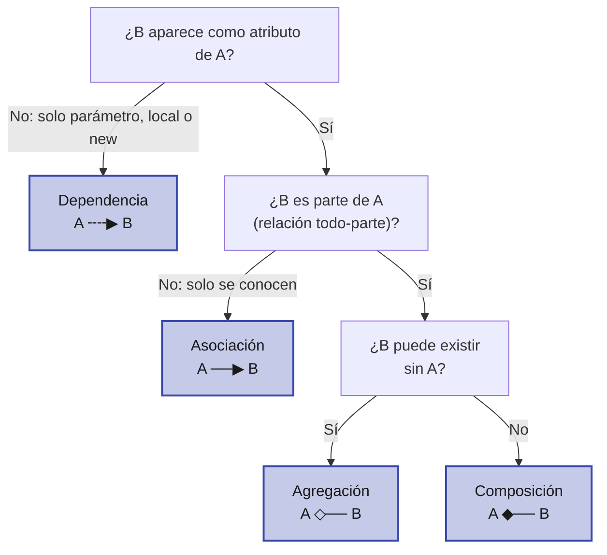
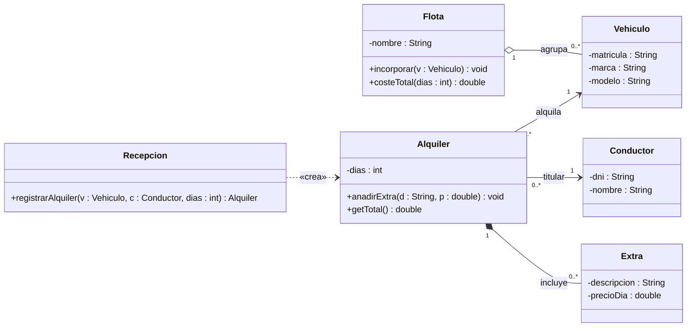
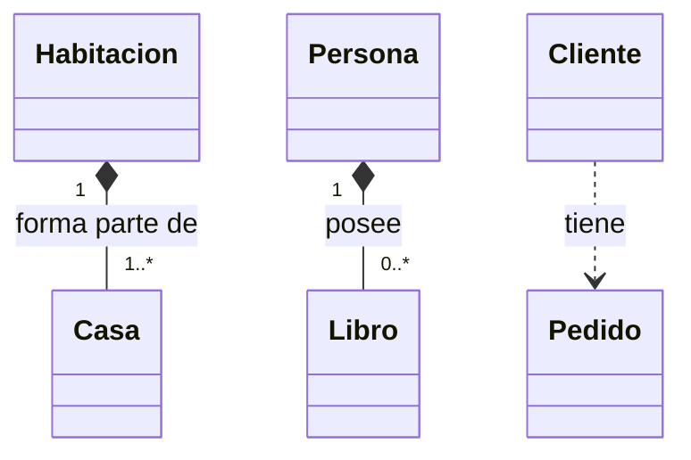

# 6. Agregación, composición y dependencia

En el capítulo 5 viste la asociación simple: «un alquiler conoce a su vehículo». Pero no todas las conexiones entre objetos son iguales. Una **flota** *está formada por* vehículos; un **alquiler** *incluye* unos extras que no tendrían sentido sin él; una **factura** *usa* un alquiler solo mientras se imprime. UML distingue estos matices con tres relaciones nuevas: la **agregación**, la **composición** y la **dependencia**. Saber elegir entre ellas es una de las cosas que más se preguntan al interpretar o construir un diagrama de clases.

## 6.1. Panorama: ¿qué relaciones hay?

| Relación | Idea | Se lee | Línea |
|---|---|---|---|
| **Asociación** | Un objeto **conoce** a otro | «tiene una referencia a» | `──────` (o `──────▶`) |
| **Agregación** | El todo **agrupa** partes que **existen por sí solas** | «está formado por» | `◇──────` |
| **Composición** | El todo **contiene** partes que **no existen sin él** | «está compuesto de» | `◆──────` |
| **Dependencia** | Un objeto **usa** a otro de forma **temporal** | «usa a» | `╌╌╌╌╌▶` |
| Herencia / realización | Una clase **es un tipo de** otra | «es un» | Capítulo 7 |

Las tres primeras son relaciones **estructurales** (se convierten en **atributos**); la dependencia es **de uso** (aparece en **parámetros, variables locales o instanciaciones**, no en campos).

## 6.2. Agregación

La **agregación** es una relación **todo–parte** «débil»: un objeto (el **todo**) agrupa a otros (las **partes**), pero **las partes tienen vida propia**. Se dibuja con un **rombo vacío** en el extremo del todo.

Una `Flota` agrupa vehículos, pero los vehículos **existen antes** de meterse en la flota y **siguen existiendo** si la flota se disuelve. En el `Main` del curso de POO los vehículos se crean fuera y la flota solo los recibe:

=== "Diagrama"

    ```mermaid
    classDiagram
        class Flota {
            -nombre : String
            +incorporar(v : Vehiculo) void
            +retirar(v : Vehiculo) void
        }
        class Vehiculo {
            -matricula : String
        }
        Flota "1" o-- "0..*" Vehiculo : agrupa
    ```

=== "PlantUML"

    ```text
    @startuml
    skinparam classAttributeIconSize 0

    class Flota {
      - nombre : String
      + incorporar(v : Vehiculo) : void
      + retirar(v : Vehiculo) : void
    }
    class Vehiculo {
      - matricula : String
    }
    Flota "1" o-- "0..*" Vehiculo : agrupa
    @enduml
    ```

=== "Java"

    ```java
    public class Flota {
        private final List<Vehiculo> vehiculos = new ArrayList<>();

        // Los vehículos llegan YA CREADOS desde fuera
        public void incorporar(Vehiculo vehiculo) {
            vehiculos.add(vehiculo);
        }
    }

    // En Main:
    Vehiculo focus = new Coche("5671BCD", "Ford", "Focus", "rojo", 130, 5);
    Flota flota = new Flota("Flota Centro");
    flota.incorporar(focus);
    flota = null;       // la flota desaparece...
    // ...pero «focus» sigue existiendo y puede entrar en otra flota
    ```

Pistas de que una relación es una **agregación**:

- La parte **se crea fuera** del todo y se **recibe** (por un método o el constructor).
- La parte **puede pertenecer a otro todo** o cambiar de uno a otro.
- Si el todo **desaparece, las partes siguen existiendo**.
- Se corresponde con un atributo (normalmente una **colección**) de objetos «prestados».

Otros ejemplos: un **equipo** tiene **jugadores** (el jugador cambia de equipo); un **departamento** agrupa **profesores**; una **biblioteca** tiene **libros**; un **cine** tiene **películas** en cartelera.

## 6.3. Composición

La **composición** es una relación todo–parte «fuerte»: las partes **dependen del todo** y **no tienen sentido sin él**. Se dibuja con un **rombo relleno** en el extremo del todo.

Los **extras** de un alquiler (el GPS, la silla infantil) los crea el alquiler, solo existen dentro de él, y cuando el alquiler se elimina se van con él. En el `Alquiler` del curso de POO, el propio alquiler crea los extras:

=== "Diagrama"

    ```mermaid
    classDiagram
        class Alquiler {
            -dias : int
            +anadirExtra(descripcion : String, precioDia : double) void
            +getTotal() double
        }
        class Extra {
            -descripcion : String
            -precioDia : double
        }
        Alquiler "1" *-- "0..*" Extra : incluye
    ```

=== "PlantUML"

    ```text
    @startuml
    skinparam classAttributeIconSize 0

    class Alquiler {
      - dias : int
      + anadirExtra(descripcion : String, precioDia : double) : void
      + getTotal() : double
    }
    class Extra {
      - descripcion : String
      - precioDia : double
    }
    Alquiler "1" *-- "0..*" Extra : incluye
    @enduml
    ```

=== "Java"

    ```java
    public class Alquiler {
        private final List<Extra> extras = new ArrayList<>();

        // El alquiler CREA los extras: nadie se los da hecho
        public void anadirExtra(String descripcion, double precioDia) {
            extras.add(new Extra(descripcion, precioDia));
        }
    }
    ```

Pistas de que una relación es una **composición**:

- La parte **se crea dentro** del todo (`new` en un método o en el constructor del todo).
- La parte **no se comparte**: pertenece a **un único** todo.
- Si el todo **se elimina, las partes desaparecen** con él.
- La multiplicidad del extremo del todo es **siempre `1`** (una parte no puede estar en dos todos a la vez, ni existir sin ninguno).

Otros ejemplos:

| Todo | Partes | Por qué es composición |
|---|---|---|
| `Pedido` | `LineaPedido` | Una línea no tiene sentido fuera de su pedido |
| `Libro` | `Capitulo` | Si se destruye el libro, sus capítulos dejan de existir |
| `Casa` | `Habitacion` | Una habitación pertenece a una sola casa |
| `Factura` | `Concepto` | Los conceptos solo existen dentro de su factura |

## 6.4. Agregación frente a composición

| Criterio | **Agregación** ◇ | **Composición** ◆ |
|---|---|---|
| ¿Existe la parte sin el todo? | **Sí** | **No** |
| ¿Quién crea la parte? | Alguien **externo** | El **propio todo** |
| ¿Puede compartirse entre varios todos? | **Sí** | **No** |
| Multiplicidad en el extremo del todo | Cualquiera (`1`, `0..1`, `*`) | **Siempre `1`** (o `0..1`) |
| Si el todo se elimina… | La parte **sigue** viva | La parte **se elimina** |
| Ejemplo del curso | `Flota ◇── Vehiculo` | `Alquiler ◆── Extra` |

### Para decidir en un caso concreto

Hazte tres preguntas sobre la parte:

1. **¿Seguiría existiendo si desaparece el todo?** Sí → agregación. No → composición.
2. **¿Podría estar en otro todo distinto?** Sí → agregación. No → composición.
3. **¿Quién la crea?** Fuera → agregación. El todo → composición.

!!! example "Ejemplos resueltos"
    | Frase | Relación | Justificación |
    |---|---|---|
    | «Un coche tiene un motor» | Composición | El motor se fabrica para ese coche y no se comparte |
    | «Un coche tiene conductores habituales» | Asociación | Los conductores existen por sí solos y no «forman parte» del coche |
    | «Un equipo tiene jugadores» | Agregación | Los jugadores existen sin el equipo y pueden cambiar |
    | «Una playlist tiene canciones» | Agregación | Una canción puede estar en varias listas |
    | «Una factura tiene líneas» | Composición | Una línea no existe sin su factura |
    | «Una empresa tiene empleados» | Agregación | Los empleados existen sin esa empresa |

!!! warning "En caso de duda, asociación"
    La diferencia entre asociación y agregación es **muy sutil**: la agregación casi no añade información a una asociación normal, y muchos autores recomiendan no usarla si no se está seguro. La **composición**, en cambio, sí tiene consecuencias claras (la parte vive y muere con el todo). En este curso debes **saber interpretar y dibujar las tres**, pero si en un problema no está clara la diferencia entre agregación y asociación, justifica tu elección en el diagrama.

## 6.5. Dependencia

La **dependencia** es la relación **más débil**: una clase **usa** a otra de forma **temporal** (durante la ejecución de una operación) y **no la guarda** como parte de su estado. Se dibuja con una **línea discontinua** y una **flecha abierta** que apunta a la clase de la que se depende:

```text
A ╌╌╌╌╌╌▶ B        «A depende de B»  (si B cambia, A puede verse afectada)
```

### ¿Cuándo aparece una dependencia?

Una clase `A` depende de `B` si, **sin tener un atributo de tipo `B`**, en algún método de `A`:

| Situación | Ejemplo |
|---|---|
| `B` es **parámetro** de un método | `void imprimir(Alquiler a)` |
| `B` es el tipo de **retorno** | `Alquiler registrar(...)` |
| `B` es una **variable local** | `Extra e = ...;` dentro de un método |
| `A` **crea** objetos de `B` con `new` y no los guarda | `new Alquiler(...)` y devolverlo |
| `A` llama a un método **estático** de `B` | `Math.max(...)` |

### Ejemplo: la recepción del taller

Imagina una clase `Recepcion` que atiende al cliente: recibe un `Vehiculo` y un `Conductor`, **crea** el `Alquiler` y lo devuelve. No guarda ninguno de ellos en un atributo, así que **no hay asociación**: solo **dependencias**.

=== "Diagrama"

    ```mermaid
    classDiagram
        class Recepcion {
            +registrarAlquiler(v : Vehiculo, c : Conductor, dias : int) Alquiler
        }
        class Vehiculo
        class Conductor
        class Alquiler
        Recepcion ..> Vehiculo : «usa»
        Recepcion ..> Conductor : «usa»
        Recepcion ..> Alquiler : «crea»
    ```

=== "PlantUML"

    ```text
    @startuml
    skinparam classAttributeIconSize 0

    class Recepcion {
      + registrarAlquiler(v : Vehiculo, c : Conductor, dias : int) : Alquiler
    }
    Recepcion ..> Vehiculo : <<use>>
    Recepcion ..> Conductor : <<use>>
    Recepcion ..> Alquiler : <<instantiate>>
    @enduml
    ```

=== "Java"

    ```java
    public class Recepcion {
        // Ningún atributo de tipo Vehiculo, Conductor ni Alquiler:
        // solo los usa dentro del método

        public Alquiler registrarAlquiler(Vehiculo v, Conductor c, int dias) {
            return new Alquiler(v, c, dias);   // «crea»: instancia y devuelve
        }
    }
    ```

La dependencia se puede **etiquetar con un estereotipo** que indica el tipo de uso: `«usa»` (el más común, y el que se supone si no se escribe nada), `«crea»` (instancia objetos), `«llama»` (invoca un método), `«importa»` (entre paquetes, capítulo 8).

### Otro ejemplo: imprimir una factura

=== "Diagrama"

    ```mermaid
    classDiagram
        class Factura {
            +imprimir(a : Alquiler) void
        }
        class Alquiler {
            +getTotal() double
        }
        Factura ..> Alquiler : «usa»
    ```

=== "Java"

    ```java
    public class Factura {
        public void imprimir(Alquiler a) {          // Alquiler solo como parámetro
            System.out.println("Total: " + a.getTotal() + " EUR");
        }
    }
    ```

### Dependencia frente a asociación

Es la confusión más habitual. La pregunta clave es: **¿la clase guarda al otro objeto como parte de su estado?**

| | **Asociación** | **Dependencia** |
|---|---|---|
| ¿Aparece en el código como… | un **atributo** (campo) | un **parámetro**, variable local o `new` dentro de un método |
| Duración | **Larga**: mientras viva el objeto | **Corta**: lo que dura la operación |
| Línea | Continua (`────▶`) | Discontinua (`╌╌╌▶`) |
| Ejemplo | `Alquiler` guarda su `Vehiculo` | `Factura` recibe un `Alquiler` para imprimirlo |

!!! tip "No dibujes la dependencia si ya hay una relación"
    Si `Alquiler` ya está **asociado** con `Vehiculo`, no dibujes además una dependencia entre ambos aunque algún método reciba un `Vehiculo`. La relación más fuerte **ya lo incluye** y el diagrama se llenaría de líneas redundantes.

### Dependencias y acoplamiento

Cada flecha de dependencia es un lugar donde un cambio **se puede propagar**: si cambia la clase `Alquiler`, hay que revisar `Factura` y `Recepcion`. Un buen diseño intenta mantener **pocas dependencias** (**bajo acoplamiento**) y evitar los **ciclos** (`A ╌▶ B` y `B ╌▶ A`), porque dos clases que se necesitan mutuamente no se pueden entender, probar ni reutilizar por separado.

## 6.6. Guía para elegir la relación

Cuando dudes, sigue este camino. Se pregunta primero **cómo se guarda** y después **qué clase de vínculo** es.



Y para el caso **«A es un tipo de B»**, que no aparece aquí, usarás la **herencia** (capítulo 7).

## 6.7. El modelo de la empresa de alquiler hasta ahora

Reunimos todo lo visto en los capítulos 5 y 6 sobre el modelo del curso de POO. Cada tipo de relación del diagrama se corresponde con una decisión de diseño que ya conoces del código:



| Relación | Por qué |
|---|---|
| `Flota ◇── Vehiculo` | La flota **agrupa** vehículos que existen por sí mismos (agregación) |
| `Alquiler ──▶ Vehiculo` | El alquiler **conoce** su vehículo, pero no lo posee (asociación) |
| `Alquiler ──▶ Conductor` | Igual: el conductor existe antes del alquiler (asociación) |
| `Alquiler ◆── Extra` | Los extras **nacen y mueren** con el alquiler (composición) |
| `Recepcion ╌▶ Alquiler` | La recepción **crea** alquileres pero no los guarda (dependencia) |

## Resumen del capítulo

- **Agregación** (`◇`): el todo **agrupa** partes que **existen por sí solas**; pueden compartirse y se crean fuera.
- **Composición** (`◆`): las partes **no existen sin el todo**, no se comparten y las crea el propio todo; multiplicidad `1` en el extremo del todo.
- Ante la duda entre asociación y agregación, usa la **asociación**; la composición solo cuando haya **dependencia de vida** clara.
- **Dependencia** (`╌╌▶`): uso **temporal** (parámetro, variable local, `new`), sin guardar el objeto en un atributo.
- Asociación, agregación y composición se traducen en **atributos**; la dependencia, en **parámetros, retornos o variables locales**.
- Menos dependencias significa **menos acoplamiento**; evita los **ciclos**.

## Actividades

**Actividad 1.** Clasifica cada frase como **asociación**, **agregación**, **composición** o **dependencia** y justifica la respuesta:

1. Un curso tiene alumnos matriculados.
2. Un libro está formado por capítulos.
3. Un cajero automático usa una tarjeta que el cliente le introduce para una operación concreta.
4. Un ordenador tiene una placa base y una memoria RAM que se fabrican para él.
5. Una asociación deportiva reúne clubes que podrían pertenecer también a otra federación.
6. Un empleado trabaja en una empresa.

??? success "Solución"
    1. **Agregación** (o asociación): los alumnos existen sin el curso y pueden estar en otros cursos.
    2. **Composición**: los capítulos no tienen sentido sin el libro y no se comparten.
    3. **Dependencia**: la tarjeta se usa solo durante la operación y no se guarda en el cajero.
    4. **Composición**: se crean para ese ordenador y desaparecen con él. (Hoy en día la RAM suele poder cambiarse de un equipo a otro; en ese caso sería agregación. Lo importante es **justificar** la elección según el enunciado.)
    5. **Agregación**: los clubes existen sin la asociación y pueden estar en otra.
    6. **Asociación**: el empleado y la empresa se conocen, pero ninguno «forma parte» del otro.

**Actividad 2.** Dibuja el diagrama de clases de este enunciado, con multiplicidades y el tipo de relación correcto:

> Una universidad está formada por departamentos; si la universidad desaparece, sus departamentos también. Cada departamento agrupa profesores, pero los profesores pueden cambiar de departamento y siguen existiendo aunque el departamento se cierre.

??? success "Solución"
    ```mermaid
    classDiagram
        class Universidad {
            -nombre : String
        }
        class Departamento {
            -nombre : String
        }
        class Profesor {
            -dni : String
            -nombre : String
        }
        Universidad "1" *-- "1..*" Departamento : está formada por
        Departamento "0..1" o-- "0..*" Profesor : agrupa
    ```

    - **Universidad ◆ Departamento**: los departamentos desaparecen con la universidad → **composición**, con multiplicidad `1` en el lado del todo.
    - **Departamento ◇ Profesor**: los profesores existen sin el departamento y pueden cambiar de uno a otro → **agregación**. El `0..1` indica que un profesor puede no estar asignado a ningún departamento en un momento dado.

**Actividad 3.** Dibuja el diagrama de clases que corresponde a este código y nombra el tipo de cada relación:

```java
public class Ordenador {
    private Placa placa = new Placa();
    private List<Periferico> perifericos = new ArrayList<>();

    public void conectar(Periferico p) {
        perifericos.add(p);
    }

    public void imprimirInforme(Informe informe) {
        // ...
    }
}
```

??? success "Solución"
    ```mermaid
    classDiagram
        class Ordenador {
            +conectar(p : Periferico) void
            +imprimirInforme(informe : Informe) void
        }
        class Placa
        class Periferico
        class Informe
        Ordenador "1" *-- "1" Placa
        Ordenador "1" o-- "0..*" Periferico
        Ordenador ..> Informe : «usa»
    ```

    - `placa = new Placa()`: la crea el propio `Ordenador` y es un atributo → **composición**.
    - `perifericos`: una colección de objetos **recibidos** por `conectar` → **agregación**, con multiplicidad `0..*`.
    - `Informe` solo aparece como **parámetro** → **dependencia**.

**Actividad 4.** Un cajero automático recibe la tarjeta de un cliente, **consulta** su `Cuenta` y devuelve un `Recibo` que él mismo crea. El cajero no guarda ni la cuenta ni el recibo. Dibuja las clases y las relaciones.

??? success "Solución"
    ```mermaid
    classDiagram
        class Cajero {
            +retirar(c : Cuenta, cantidad : double) Recibo
        }
        class Cuenta {
            -saldo : double
        }
        class Recibo {
            -importe : double
        }
        Cajero ..> Cuenta : «usa»
        Cajero ..> Recibo : «crea»
    ```

    El cajero **no tiene atributos** de tipo `Cuenta` ni `Recibo`, así que no hay asociación: solo dependencias. Una usa a `Cuenta` como **parámetro** y otra **crea** el `Recibo`.

**Actividad 5.** Encuentra los **errores** de este diagrama y dibújalo corregido:



??? success "Solución"
    1. **Rombo en el extremo equivocado.** El rombo va en el lado del **todo**, y el todo es la `Casa`, no la `Habitacion`. Además las multiplicidades están al revés: una casa tiene muchas habitaciones, no al contrario.
    2. **Composición mal usada.** Un libro **sigue existiendo** si su propietario desaparece (y puede pasar a otra persona), así que no es composición: es una **asociación** o, como mucho, una agregación.
    3. **Dependencia usada como asociación.** «Un cliente **tiene** pedidos» describe una relación **permanente** (atributo), no un uso temporal: es una **asociación**.

    ```mermaid
    classDiagram
        Casa "1" *-- "1..*" Habitacion : tiene
        Persona "1" -- "0..*" Libro : posee
        Cliente "1" --> "0..*" Pedido : realiza
    ```
